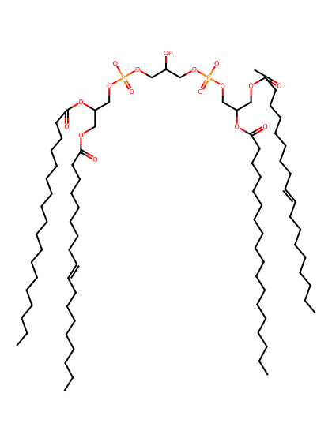
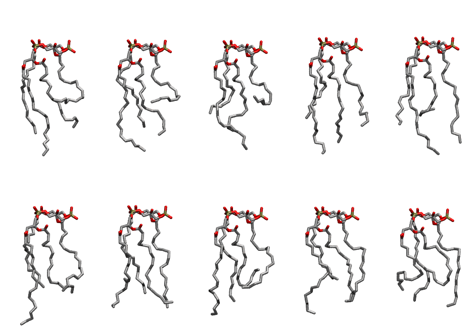

.. _lipid_gallery lnccl2:

LNCCL2
======

**3 linoleic acid + 1 linolenic acid cardiolipin with head group charge = -2**

==============  ======================================
CHARMM resname  ``LNCCL2``
Net charge      -2.00
Atoms           238
Topology file   ``toppar_all36_lipid_cardiolipin.str``
Conformers      10 fluid
==============  ======================================

Structure
---------

Conformers
----------

The grid packer draws a conformer per lipid from this ensemble, so what the ensemble contains is what a built bilayer is made of. A leaflet declared ``phase: Lo`` generates an ordered ensemble when a build first needs it. All conformers are rendered at one shared scale.

=============  =============  ================  ================
Conformer      Head-tail (Å)  Max internal (Å)  Min chain extent
=============  =============  ================  ================
``LNCCL2-00``  7.05           26.87             0.43
``LNCCL2-01``  7.50           25.06             0.46
``LNCCL2-02``  6.20           24.87             0.40
``LNCCL2-03``  11.24          26.88             0.70
``LNCCL2-04``  9.52           26.68             0.48
``LNCCL2-05``  11.31          27.59             0.61
``LNCCL2-06``  12.74          24.60             0.70
``LNCCL2-07``  7.61           25.46             0.39
``LNCCL2-08``  9.57           24.58             0.65
``LNCCL2-09``  7.27           23.46             0.37
=============  =============  ================  ================

*Min chain extent* is how far the least-extended acyl chain descends below its own attachment carbon, as a fraction of that chain's all-trans contour; an all-trans chain scores 1.0, and a conformer under 0.25 is rejected at generation as folded.

Provenance
----------

How the ensemble was generated, read from the entry's own ``info.yaml``:

===================  ============
Setting              ``LNCCL2``
===================  ============
Sampler              ``mc``
Phase                none (fluid)
Trans bias           0.0
Chain order          0.171
MC seed              0
Chains               4
Cylinder APL         120.0 Ų
Cylinder inflation   1.9
Equilibration steps  20000
Decorrelation steps  3000
Max MC angle         30°
Radius scale         0.8
Axial bias           1.0
===================  ============
