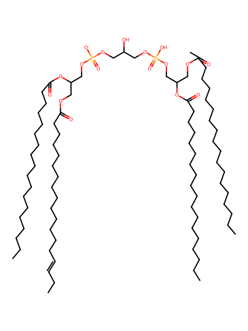
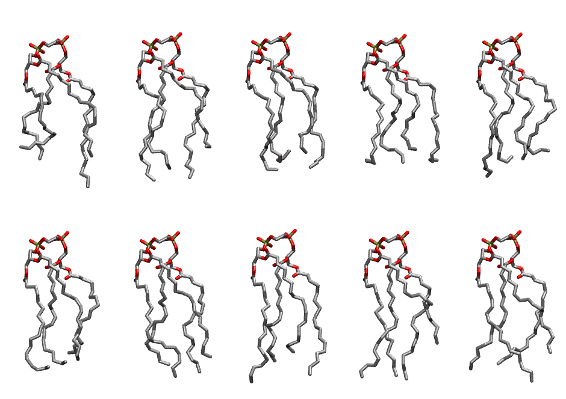

.. _lipid_gallery lndcl1:

LNDCL1
======

**3 Linoleic acid + 1 linolenic acid cardiolipin with head group charge = -1**

==============  ======================================
CHARMM resname  ``LNDCL1``
Net charge      -1.00
Atoms           239
Topology file   ``toppar_all36_lipid_cardiolipin.str``
Conformers      10 fluid
==============  ======================================

Structure
---------

Conformers
----------

The grid packer draws a conformer per lipid from this ensemble, so what the ensemble contains is what a built bilayer is made of. A leaflet declared ``phase: Lo`` generates an ordered ensemble when a build first needs it. All conformers are rendered at one shared scale.

=============  =============  ================  ================
Conformer      Head-tail (Å)  Max internal (Å)  Min chain extent
=============  =============  ================  ================
``LNDCL1-00``  10.39          26.53             0.48
``LNDCL1-01``  10.79          25.86             0.67
``LNDCL1-02``  11.56          24.23             0.54
``LNDCL1-03``  10.96          24.44             0.62
``LNDCL1-04``  11.44          25.27             0.57
``LNDCL1-05``  12.00          26.32             0.59
``LNDCL1-06``  12.66          25.42             0.74
``LNDCL1-07``  12.23          27.97             0.75
``LNDCL1-08``  10.48          27.52             0.67
``LNDCL1-09``  12.10          26.71             0.69
=============  =============  ================  ================

*Min chain extent* is how far the least-extended acyl chain descends below its own attachment carbon, as a fraction of that chain's all-trans contour; an all-trans chain scores 1.0, and a conformer under 0.25 is rejected at generation as folded.

Provenance
----------

How the ensemble was generated, read from the entry's own ``info.yaml``:

===================  ============
Setting              ``LNDCL1``
===================  ============
Sampler              ``mc``
Phase                none (fluid)
Trans bias           0.0
Chain order          0.159
MC seed              0
Chains               4
Cylinder APL         120.0 Ų
Cylinder inflation   1.9
Equilibration steps  20000
Decorrelation steps  3000
Max MC angle         30°
Radius scale         0.8
Axial bias           1.0
===================  ============
