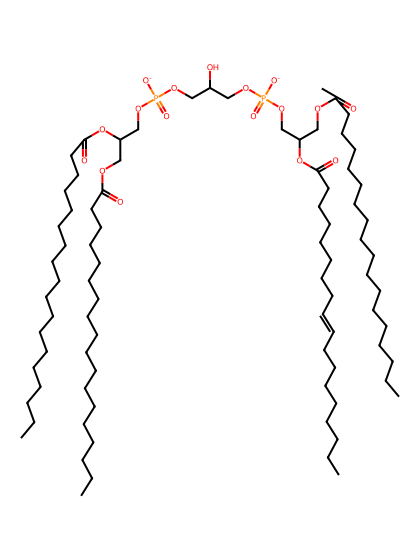
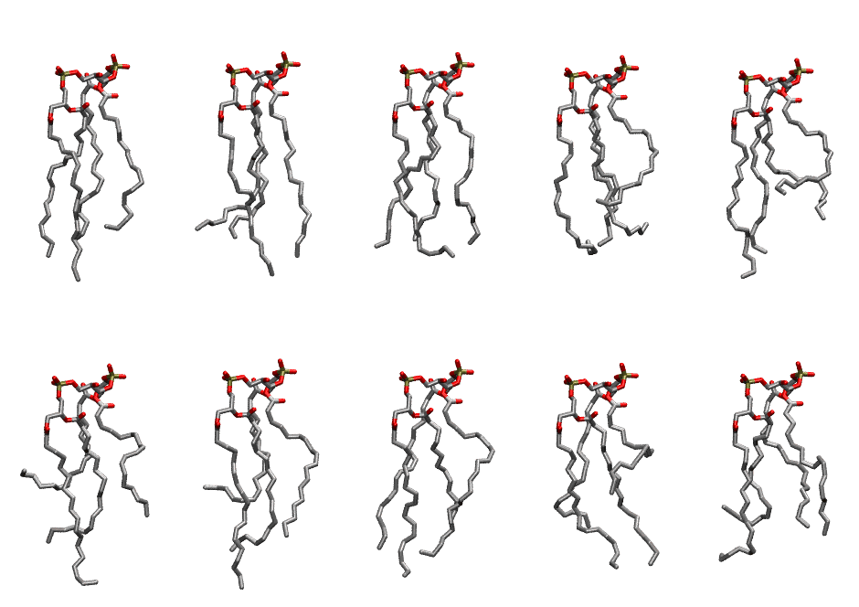

.. _lipid_gallery lndcl2:

LNDCL2
======

**3 linoleic acid + 1 linolenic acid cardiolipin with head group charge = -2**

==============  ======================================
CHARMM resname  ``LNDCL2``
Net charge      -2.00
Atoms           238
Topology file   ``toppar_all36_lipid_cardiolipin.str``
Conformers      10 fluid
==============  ======================================

Structure
---------

Conformers
----------

The grid packer draws a conformer per lipid from this ensemble, so what the ensemble contains is what a built bilayer is made of. A leaflet declared ``phase: Lo`` generates an ordered ensemble when a build first needs it. All conformers are rendered at one shared scale.

=============  =============  ================  ================
Conformer      Head-tail (Å)  Max internal (Å)  Min chain extent
=============  =============  ================  ================
``LNDCL2-00``  12.74          27.93             0.72
``LNDCL2-01``  13.29          27.15             0.67
``LNDCL2-02``  14.47          25.80             0.73
``LNDCL2-03``  9.53           24.31             0.57
``LNDCL2-04``  8.22           28.13             0.51
``LNDCL2-05``  4.96           27.34             0.42
``LNDCL2-06``  7.51           28.16             0.54
``LNDCL2-07``  11.64          27.01             0.67
``LNDCL2-08``  7.65           25.78             0.48
``LNDCL2-09``  9.52           26.03             0.49
=============  =============  ================  ================

*Min chain extent* is how far the least-extended acyl chain descends below its own attachment carbon, as a fraction of that chain's all-trans contour; an all-trans chain scores 1.0, and a conformer under 0.25 is rejected at generation as folded.

Provenance
----------

How the ensemble was generated, read from the entry's own ``info.yaml``:

===================  ============
Setting              ``LNDCL2``
===================  ============
Sampler              ``mc``
Phase                none (fluid)
Trans bias           0.0
Chain order          0.192
MC seed              0
Chains               4
Cylinder APL         120.0 Ų
Cylinder inflation   1.9
Equilibration steps  20000
Decorrelation steps  3000
Max MC angle         30°
Radius scale         0.8
Axial bias           1.0
===================  ============
