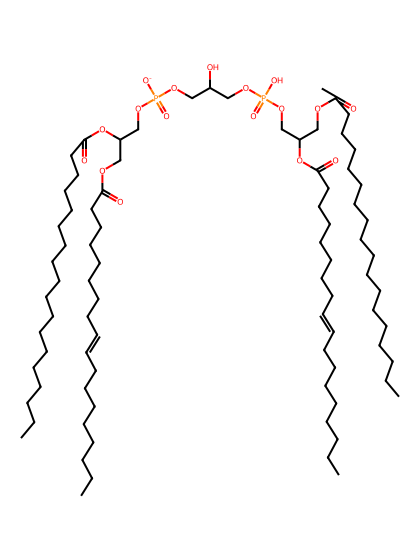
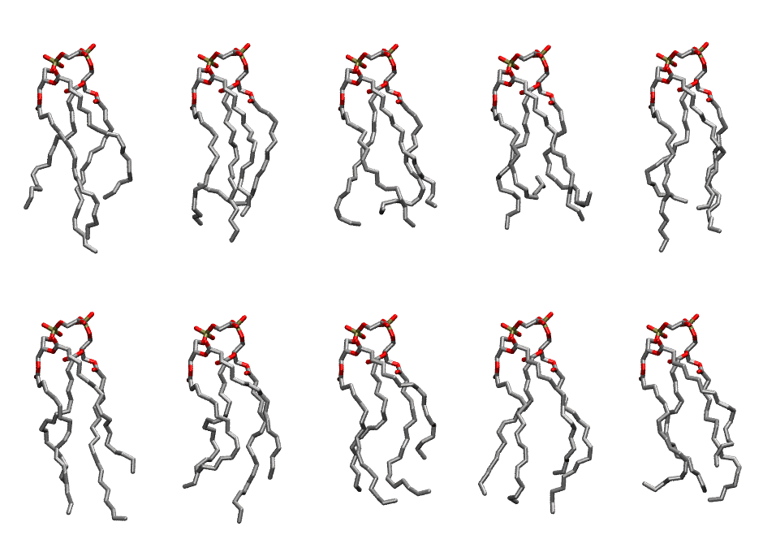

.. _lipid_gallery loacl1:

LOACL1
======

**3 Linoleic acid + 1 oleic acid cardiolipin with head group charge = -1**

==============  ======================================
CHARMM resname  ``LOACL1``
Net charge      -1.00
Atoms           243
Topology file   ``toppar_all36_lipid_cardiolipin.str``
Conformers      10 fluid
==============  ======================================

Structure
---------

Conformers
----------

The grid packer draws a conformer per lipid from this ensemble, so what the ensemble contains is what a built bilayer is made of. A leaflet declared ``phase: Lo`` generates an ordered ensemble when a build first needs it. All conformers are rendered at one shared scale.

=============  =============  ================  ================
Conformer      Head-tail (Å)  Max internal (Å)  Min chain extent
=============  =============  ================  ================
``LOACL1-00``  11.19          27.12             0.69
``LOACL1-01``  9.61           25.75             0.49
``LOACL1-02``  12.20          25.42             0.63
``LOACL1-03``  8.51           24.67             0.40
``LOACL1-04``  11.87          27.85             0.66
``LOACL1-05``  11.93          27.79             0.73
``LOACL1-06``  11.77          26.77             0.62
``LOACL1-07``  9.87           26.44             0.64
``LOACL1-08``  12.08          26.76             0.73
``LOACL1-09``  10.88          24.83             0.62
=============  =============  ================  ================

*Min chain extent* is how far the least-extended acyl chain descends below its own attachment carbon, as a fraction of that chain's all-trans contour; an all-trans chain scores 1.0, and a conformer under 0.25 is rejected at generation as folded.

Provenance
----------

How the ensemble was generated, read from the entry's own ``info.yaml``:

===================  ============
Setting              ``LOACL1``
===================  ============
Sampler              ``mc``
Phase                none (fluid)
Trans bias           0.0
Chain order          0.177
MC seed              0
Chains               4
Cylinder APL         120.0 Ų
Cylinder inflation   1.9
Equilibration steps  20000
Decorrelation steps  3000
Max MC angle         30°
Radius scale         0.8
Axial bias           1.0
===================  ============
