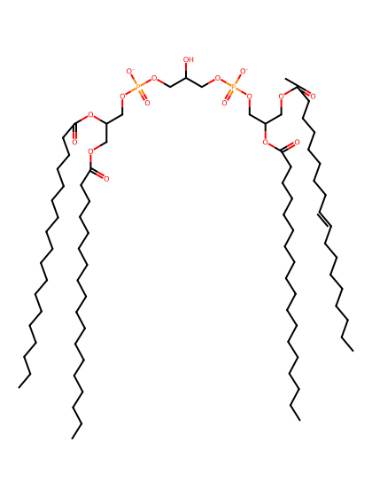
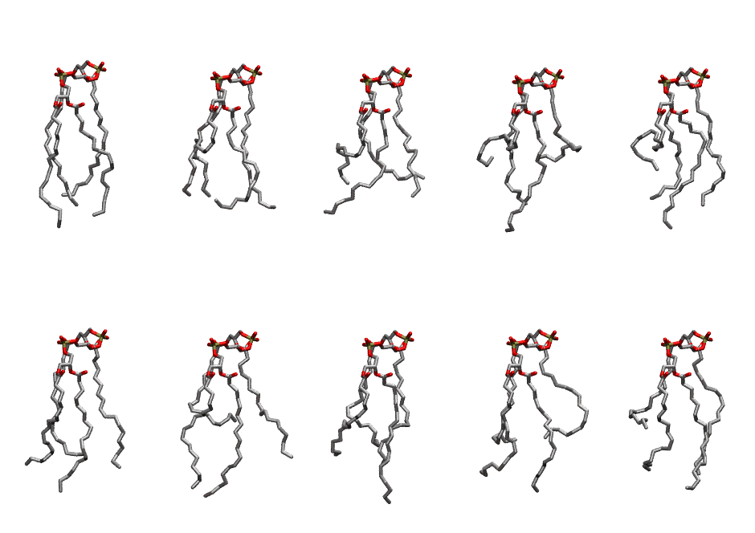

.. _lipid_gallery loacl2:

LOACL2
======

**3 linoleoic acid + 1 oleic acid chain, Cardiolipin with head group charge = -2**

==============  ======================================
CHARMM resname  ``LOACL2``
Net charge      -2.00
Atoms           242
Topology file   ``toppar_all36_lipid_cardiolipin.str``
Conformers      10 fluid
==============  ======================================

Structure
---------

Conformers
----------

The grid packer draws a conformer per lipid from this ensemble, so what the ensemble contains is what a built bilayer is made of. A leaflet declared ``phase: Lo`` generates an ordered ensemble when a build first needs it. All conformers are rendered at one shared scale.

=============  =============  ================  ================
Conformer      Head-tail (Å)  Max internal (Å)  Min chain extent
=============  =============  ================  ================
``LOACL2-00``  13.69          28.69             0.76
``LOACL2-01``  13.08          24.19             0.58
``LOACL2-02``  10.21          26.30             0.48
``LOACL2-03``  6.91           26.62             0.29
``LOACL2-04``  8.76           26.40             0.38
``LOACL2-05``  12.39          26.49             0.61
``LOACL2-06``  7.00           27.09             0.52
``LOACL2-07``  10.05          27.57             0.53
``LOACL2-08``  9.72           26.08             0.63
``LOACL2-09``  8.06           27.07             0.57
=============  =============  ================  ================

*Min chain extent* is how far the least-extended acyl chain descends below its own attachment carbon, as a fraction of that chain's all-trans contour; an all-trans chain scores 1.0, and a conformer under 0.25 is rejected at generation as folded.

Provenance
----------

How the ensemble was generated, read from the entry's own ``info.yaml``:

===================  ============
Setting              ``LOACL2``
===================  ============
Sampler              ``mc``
Phase                none (fluid)
Trans bias           0.0
Chain order          0.172
MC seed              0
Chains               4
Cylinder APL         120.0 Ų
Cylinder inflation   1.9
Equilibration steps  20000
Decorrelation steps  3000
Max MC angle         30°
Radius scale         0.8
Axial bias           1.0
===================  ============
