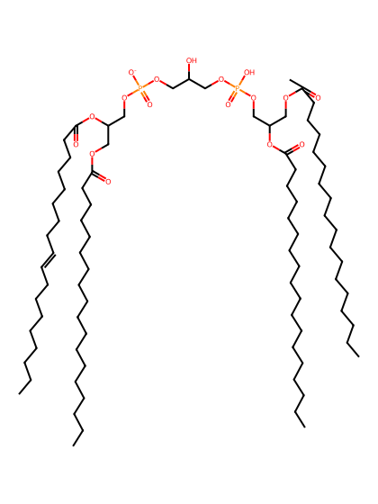
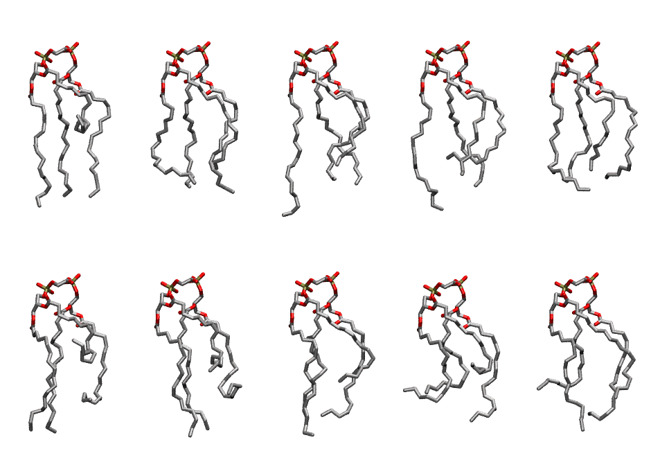

.. _lipid_gallery loccl1:

LOCCL1
======

**3 Linoleic acid + 1 oleic acid Cardiolipin with head group charge = -1**

==============  ======================================
CHARMM resname  ``LOCCL1``
Net charge      -1.00
Atoms           243
Topology file   ``toppar_all36_lipid_cardiolipin.str``
Conformers      10 fluid
==============  ======================================

Structure
---------

Conformers
----------

The grid packer draws a conformer per lipid from this ensemble, so what the ensemble contains is what a built bilayer is made of. A leaflet declared ``phase: Lo`` generates an ordered ensemble when a build first needs it. All conformers are rendered at one shared scale.

=============  =============  ================  ================
Conformer      Head-tail (Å)  Max internal (Å)  Min chain extent
=============  =============  ================  ================
``LOCCL1-00``  2.95           26.74             0.32
``LOCCL1-01``  10.83          24.14             0.61
``LOCCL1-02``  10.36          28.47             0.62
``LOCCL1-03``  9.39           26.66             0.48
``LOCCL1-04``  11.00          25.25             0.61
``LOCCL1-05``  1.86           26.39             0.27
``LOCCL1-06``  6.53           25.90             0.48
``LOCCL1-07``  8.24           26.98             0.56
``LOCCL1-08``  5.13           22.87             0.42
``LOCCL1-09``  9.25           25.66             0.54
=============  =============  ================  ================

*Min chain extent* is how far the least-extended acyl chain descends below its own attachment carbon, as a fraction of that chain's all-trans contour; an all-trans chain scores 1.0, and a conformer under 0.25 is rejected at generation as folded.

Provenance
----------

How the ensemble was generated, read from the entry's own ``info.yaml``:

===================  ============
Setting              ``LOCCL1``
===================  ============
Sampler              ``mc``
Phase                none (fluid)
Trans bias           0.0
Chain order          0.129
MC seed              0
Chains               4
Cylinder APL         120.0 Ų
Cylinder inflation   1.9
Equilibration steps  20000
Decorrelation steps  3000
Max MC angle         30°
Radius scale         0.8
Axial bias           1.0
===================  ============
