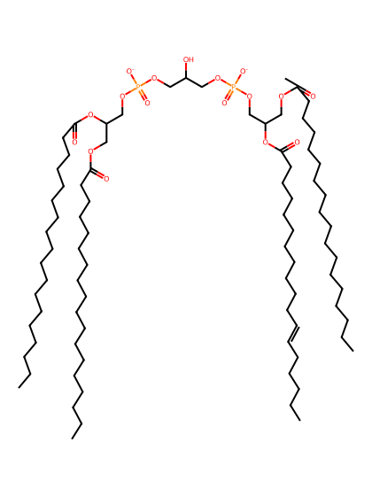
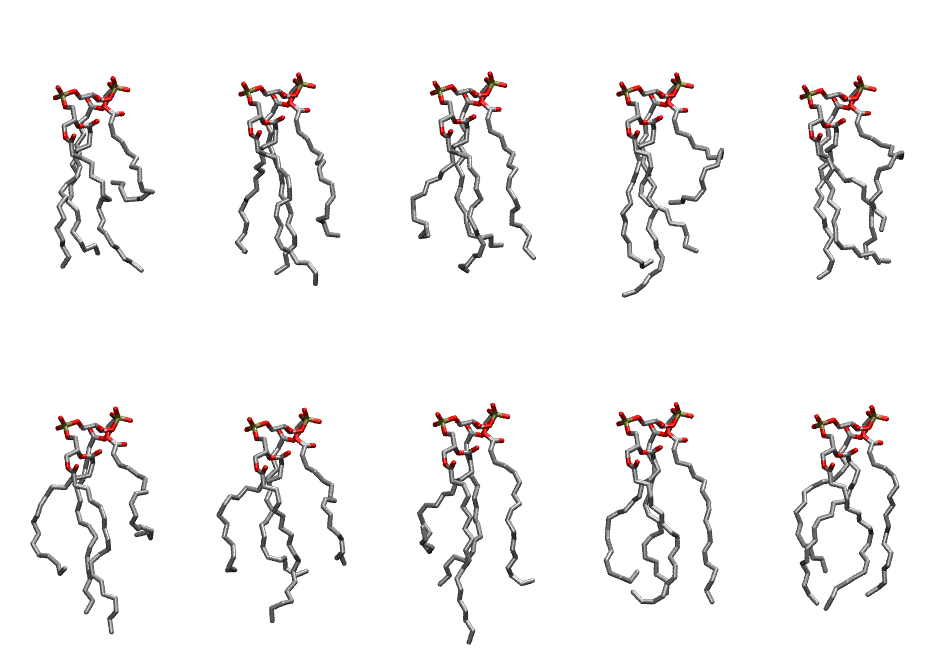

.. _lipid_gallery loccl2:

LOCCL2
======

**3 lineoleic acid + 1 oleic acid chain cardiolipin with head group charge = -2**

==============  ======================================
CHARMM resname  ``LOCCL2``
Net charge      -2.00
Atoms           242
Topology file   ``toppar_all36_lipid_cardiolipin.str``
Conformers      10 fluid
==============  ======================================

Structure
---------

Conformers
----------

The grid packer draws a conformer per lipid from this ensemble, so what the ensemble contains is what a built bilayer is made of. A leaflet declared ``phase: Lo`` generates an ordered ensemble when a build first needs it. All conformers are rendered at one shared scale.

=============  =============  ================  ================
Conformer      Head-tail (Å)  Max internal (Å)  Min chain extent
=============  =============  ================  ================
``LOCCL2-00``  5.44           24.30             0.37
``LOCCL2-01``  12.04          26.27             0.67
``LOCCL2-02``  12.17          24.48             0.62
``LOCCL2-03``  8.21           28.61             0.50
``LOCCL2-04``  11.02          24.93             0.63
``LOCCL2-05``  8.00           27.92             0.49
``LOCCL2-06``  11.18          26.36             0.61
``LOCCL2-07``  7.57           29.32             0.41
``LOCCL2-08``  12.85          25.76             0.65
``LOCCL2-09``  12.38          26.59             0.73
=============  =============  ================  ================

*Min chain extent* is how far the least-extended acyl chain descends below its own attachment carbon, as a fraction of that chain's all-trans contour; an all-trans chain scores 1.0, and a conformer under 0.25 is rejected at generation as folded.

Provenance
----------

How the ensemble was generated, read from the entry's own ``info.yaml``:

===================  ============
Setting              ``LOCCL2``
===================  ============
Sampler              ``mc``
Phase                none (fluid)
Trans bias           0.0
Chain order          0.167
MC seed              0
Chains               4
Cylinder APL         120.0 Ų
Cylinder inflation   1.9
Equilibration steps  20000
Decorrelation steps  3000
Max MC angle         30°
Radius scale         0.8
Axial bias           1.0
===================  ============
