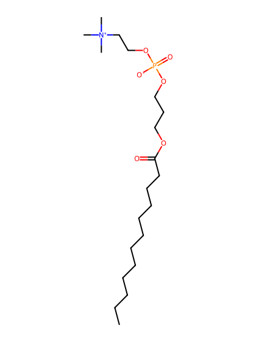
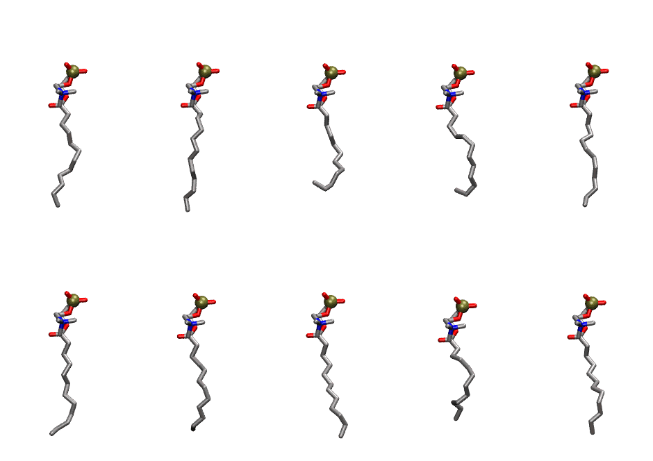
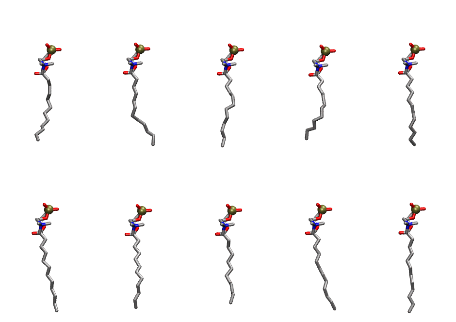

.. _lipid_gallery lppc:

LPPC
====

**deoxylysophosphatidylcholine**

==============  ==========================================
CHARMM resname  ``LPPC``
Net charge      0.00
Atoms           70
Topology file   ``top_all36_lipid.rtf``
Conformers      10 fluid, 10 liquid-ordered (``LPPC__Lo``)
==============  ==========================================

Structure
---------

Conformers
----------

The grid packer draws a conformer per lipid from an ensemble, so what the ensemble contains is what a built bilayer is made of. LPPC ships two: a fluid one, used by default, and a liquid-ordered one, used for a leaflet declared ``phase: Lo``. All conformers on this page are rendered at one shared scale.

Fluid (``LPPC``)
~~~~~~~~~~~~~~~~

===========  =============  ================  ================
Conformer    Head-tail (Å)  Max internal (Å)  Min chain extent
===========  =============  ================  ================
``LPPC-00``  12.11          18.18             0.87
``LPPC-01``  12.69          18.74             0.91
``LPPC-02``  9.22           16.30             0.66
``LPPC-03``  10.09          16.88             0.73
``LPPC-04``  12.07          18.12             0.87
``LPPC-05``  12.05          17.92             0.87
``LPPC-06``  11.25          17.38             0.81
``LPPC-07``  12.20          18.14             0.88
``LPPC-08``  9.53           15.74             0.69
``LPPC-09``  11.58          17.38             0.83
===========  =============  ================  ================

Liquid-ordered (``LPPC__Lo``)
~~~~~~~~~~~~~~~~~~~~~~~~~~~~~

===========  =============  ================  ================
Conformer    Head-tail (Å)  Max internal (Å)  Min chain extent
===========  =============  ================  ================
``LPPC-00``  11.52          17.79             0.83
``LPPC-01``  12.45          18.41             0.90
``LPPC-02``  12.51          18.51             0.90
``LPPC-03``  11.07          17.35             0.80
``LPPC-04``  12.43          18.47             0.89
``LPPC-05``  13.47          19.68             0.97
``LPPC-06``  12.68          18.99             0.91
``LPPC-07``  11.91          17.95             0.86
``LPPC-08``  13.14          19.11             0.94
``LPPC-09``  13.67          19.67             0.98
===========  =============  ================  ================

*Min chain extent* is how far the least-extended acyl chain descends below its own attachment carbon, as a fraction of that chain's all-trans contour; an all-trans chain scores 1.0, and a conformer under 0.25 is rejected at generation as folded.

Provenance
----------

How each ensemble was generated, read from the entry's own ``info.yaml``:

===================  ============  ============
Setting              ``LPPC``      ``LPPC__Lo``
===================  ============  ============
Sampler              ``mc``        ``mc``
Phase                none (fluid)  Lo
Trans bias           0.0           2.5
Chain order          0.217         0.316
MC seed              0             0
Chains               1             1
Cylinder APL         30.0 Ų       30.0 Ų
Cylinder inflation   1.9           1.9
Equilibration steps  20000         20000
Decorrelation steps  3000          3000
Max MC angle         30°           30°
Radius scale         0.8           0.8
Axial bias           1.0           1.0
===================  ============  ============
