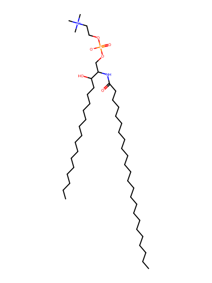
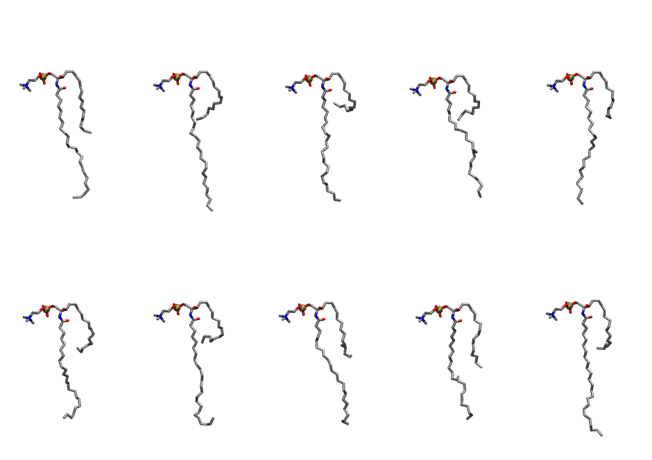
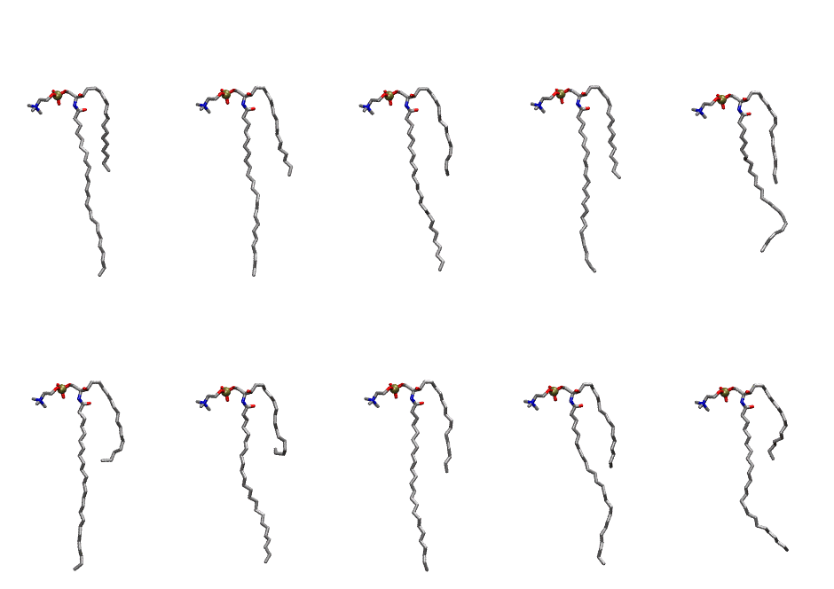

.. _lipid_gallery lsm:

LSM
===

**sphingomyelin d18:1/24:0**

==============  =========================================
CHARMM resname  ``LSM``
Net charge      0.00
Atoms           151
Topology file   ``toppar_all36_lipid_sphingo.str``
Conformers      10 fluid, 10 liquid-ordered (``LSM__Lo``)
==============  =========================================

Structure
---------

Conformers
----------

The grid packer draws a conformer per lipid from an ensemble, so what the ensemble contains is what a built bilayer is made of. LSM ships two: a fluid one, used by default, and a liquid-ordered one, used for a leaflet declared ``phase: Lo``. All conformers on this page are rendered at one shared scale.

Fluid (``LSM``)
~~~~~~~~~~~~~~~

==========  =============  ================
Conformer   Head-tail (Å)  Max internal (Å)
==========  =============  ================
``LSM-00``  9.88           30.37
``LSM-01``  6.87           32.62
``LSM-02``  2.92           30.92
``LSM-03``  6.05           30.47
``LSM-04``  5.24           31.40
``LSM-05``  6.19           27.39
``LSM-06``  5.25           29.19
``LSM-07``  8.09           30.85
``LSM-08``  10.25          27.30
``LSM-09``  6.91           31.99
==========  =============  ================

Liquid-ordered (``LSM__Lo``)
~~~~~~~~~~~~~~~~~~~~~~~~~~~~

==========  =============  ================
Conformer   Head-tail (Å)  Max internal (Å)
==========  =============  ================
``LSM-00``  10.50          34.14
``LSM-01``  11.42          34.34
``LSM-02``  11.13          34.10
``LSM-03``  11.96          33.70
``LSM-04``  11.85          29.42
``LSM-05``  9.92           34.60
``LSM-06``  7.46           32.65
``LSM-07``  11.81          34.33
``LSM-08``  10.58          33.51
``LSM-09``  9.01           32.31
==========  =============  ================

Provenance
----------

How each ensemble was generated, read from the entry's own ``info.yaml``:

===================  ============  ===========
Setting              ``LSM``       ``LSM__Lo``
===================  ============  ===========
Sampler              ``mc``        ``mc``
Phase                none (fluid)  Lo
Trans bias           0.0           6.25
Chain order          0.192         0.317
MC seed              0             0
Chains               2             2
Cylinder APL         60.0 Ų       60.0 Ų
Cylinder inflation   1.9           1.9
Equilibration steps  20000         20000
Decorrelation steps  3000          3000
Max MC angle         30°           30°
Radius scale         0.8           0.8
Axial bias           1.0           1.0
===================  ============  ===========
