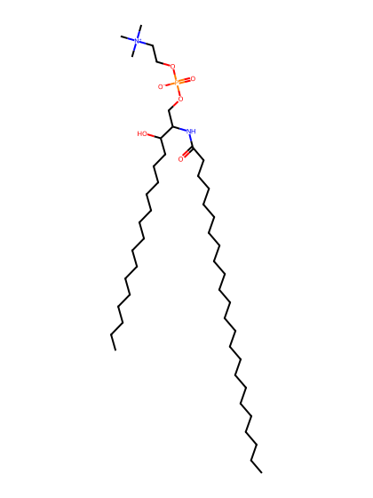
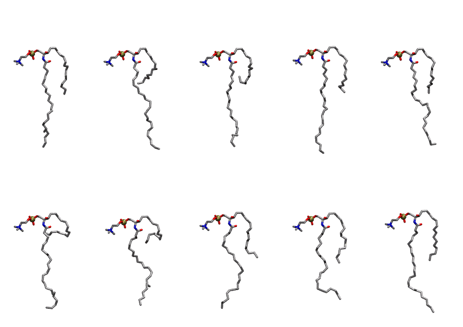

.. _lipid_gallery nsm:

NSM
===

**sphingomyelin d18:1/24:1 (w/nervonic acid)**

==============  ==================================
CHARMM resname  ``NSM``
Net charge      0.00
Atoms           149
Topology file   ``toppar_all36_lipid_sphingo.str``
Conformers      10 fluid
==============  ==================================

Structure
---------

Conformers
----------

The grid packer draws a conformer per lipid from this ensemble, so what the ensemble contains is what a built bilayer is made of. A leaflet declared ``phase: Lo`` generates an ordered ensemble when a build first needs it. All conformers are rendered at one shared scale.

==========  =============  ================
Conformer   Head-tail (Å)  Max internal (Å)
==========  =============  ================
``NSM-00``  8.77           29.86
``NSM-01``  5.77           30.18
``NSM-02``  3.85           28.54
``NSM-03``  8.48           31.36
``NSM-04``  8.24           28.68
``NSM-05``  1.47           28.16
``NSM-06``  3.30           25.75
``NSM-07``  8.39           28.58
``NSM-08``  9.62           25.71
``NSM-09``  9.64           29.91
==========  =============  ================

Provenance
----------

How the ensemble was generated, read from the entry's own ``info.yaml``:

===================  ============
Setting              ``NSM``
===================  ============
Sampler              ``mc``
Phase                none (fluid)
Trans bias           0.0
Chain order          0.150
MC seed              0
Chains               2
Cylinder APL         60.0 Ų
Cylinder inflation   1.9
Equilibration steps  20000
Decorrelation steps  3000
Max MC angle         30°
Radius scale         0.8
Axial bias           1.0
===================  ============
