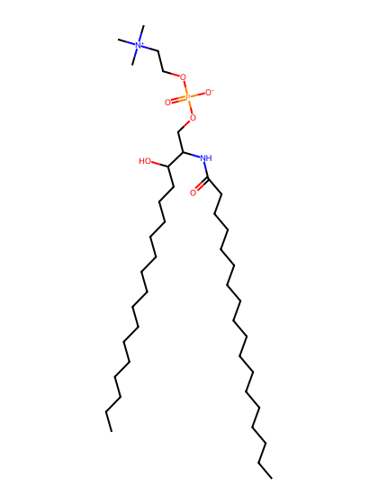
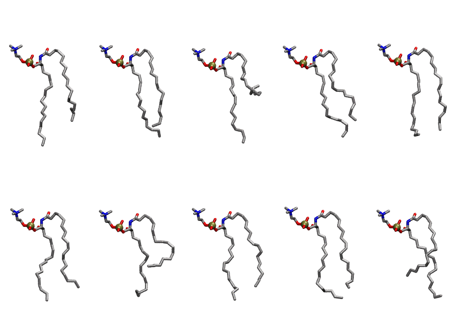

.. _lipid_gallery osm:

OSM
===

**sphingomyelin d18:1/18:1 (w/oleic acid)**

==============  ==================================
CHARMM resname  ``OSM``
Net charge      0.00
Atoms           131
Topology file   ``toppar_all36_lipid_sphingo.str``
Conformers      10 fluid
==============  ==================================

Structure
---------

Conformers
----------

The grid packer draws a conformer per lipid from this ensemble, so what the ensemble contains is what a built bilayer is made of. A leaflet declared ``phase: Lo`` generates an ordered ensemble when a build first needs it. All conformers are rendered at one shared scale.

==========  =============  ================
Conformer   Head-tail (Å)  Max internal (Å)
==========  =============  ================
``OSM-00``  12.01          23.81
``OSM-01``  13.05          24.69
``OSM-02``  4.01           24.11
``OSM-03``  11.61          24.67
``OSM-04``  14.08          23.48
``OSM-05``  12.58          22.95
``OSM-06``  7.87           21.68
``OSM-07``  12.44          22.64
``OSM-08``  12.97          24.61
``OSM-09``  9.88           23.90
==========  =============  ================

Provenance
----------

How the ensemble was generated, read from the entry's own ``info.yaml``:

===================  ============
Setting              ``OSM``
===================  ============
Sampler              ``mc``
Phase                none (fluid)
Trans bias           0.0
Chain order          0.168
MC seed              0
Chains               2
Cylinder APL         60.0 Ų
Cylinder inflation   1.9
Equilibration steps  20000
Decorrelation steps  3000
Max MC angle         30°
Radius scale         0.8
Axial bias           1.0
===================  ============
