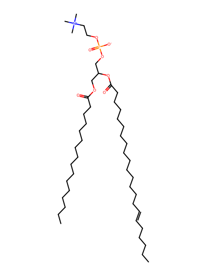
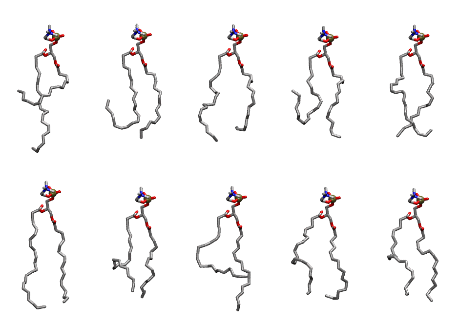

.. _lipid_gallery pdopc:

PDOPC
=====

**3-palmitoyl-2-docosahexaenoyl-D-glycero-1-phosphatidylcholine**

==============  ========================================
CHARMM resname  ``PDOPC``
Net charge      0.00
Atoms           136
Topology file   ``toppar_all36_lipid_miscellaneous.str``
Conformers      10 fluid
==============  ========================================

Structure
---------

Conformers
----------

The grid packer draws a conformer per lipid from this ensemble, so what the ensemble contains is what a built bilayer is made of. A leaflet declared ``phase: Lo`` generates an ordered ensemble when a build first needs it. All conformers are rendered at one shared scale.

============  =============  ================  ================
Conformer     Head-tail (Å)  Max internal (Å)  Min chain extent
============  =============  ================  ================
``PDOPC-00``  5.11           27.15             0.25
``PDOPC-01``  7.27           23.93             0.36
``PDOPC-02``  12.51          24.98             0.64
``PDOPC-03``  4.86           23.56             0.27
``PDOPC-04``  13.00          24.05             0.58
``PDOPC-05``  16.10          27.16             0.73
``PDOPC-06``  12.70          24.47             0.57
``PDOPC-07``  9.92           26.29             0.46
``PDOPC-08``  13.22          24.59             0.59
``PDOPC-09``  13.15          23.95             0.58
============  =============  ================  ================

*Min chain extent* is how far the least-extended acyl chain descends below its own attachment carbon, as a fraction of that chain's all-trans contour; an all-trans chain scores 1.0, and a conformer under 0.25 is rejected at generation as folded.

Provenance
----------

How the ensemble was generated, read from the entry's own ``info.yaml``:

===================  ============
Setting              ``PDOPC``
===================  ============
Sampler              ``mc``
Phase                none (fluid)
Trans bias           0.0
Chain order          0.166
MC seed              0
Chains               2
Cylinder APL         60.0 Ų
Cylinder inflation   1.9
Equilibration steps  20000
Decorrelation steps  3000
Max MC angle         30°
Radius scale         0.8
Axial bias           1.0
===================  ============
