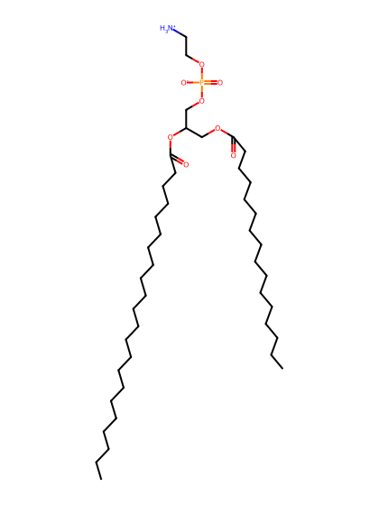
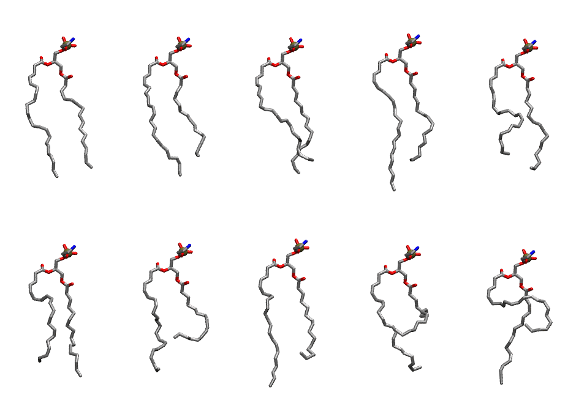

.. _lipid_gallery pdope:

PDOPE
=====

**1-Palmitoyl-2-Docosahexaenoyl-Phosphatidylethanolamine**

==============  ========================================
CHARMM resname  ``PDOPE``
Net charge      0.00
Atoms           127
Topology file   ``toppar_all36_lipid_miscellaneous.str``
Conformers      10 fluid
==============  ========================================

Structure
---------

Conformers
----------

The grid packer draws a conformer per lipid from this ensemble, so what the ensemble contains is what a built bilayer is made of. A leaflet declared ``phase: Lo`` generates an ordered ensemble when a build first needs it. All conformers are rendered at one shared scale.

============  =============  ================  ================
Conformer     Head-tail (Å)  Max internal (Å)  Min chain extent
============  =============  ================  ================
``PDOPE-00``  16.24          26.59             0.77
``PDOPE-01``  14.16          26.56             0.73
``PDOPE-02``  14.82          26.01             0.65
``PDOPE-03``  15.49          29.55             0.80
``PDOPE-04``  13.45          24.76             0.60
``PDOPE-05``  13.79          24.97             0.61
``PDOPE-06``  9.77           24.89             0.50
``PDOPE-07``  13.33          28.00             0.68
``PDOPE-08``  8.04           23.95             0.40
``PDOPE-09``  6.45           26.12             0.34
============  =============  ================  ================

*Min chain extent* is how far the least-extended acyl chain descends below its own attachment carbon, as a fraction of that chain's all-trans contour; an all-trans chain scores 1.0, and a conformer under 0.25 is rejected at generation as folded.

Provenance
----------

How the ensemble was generated, read from the entry's own ``info.yaml``:

===================  ============
Setting              ``PDOPE``
===================  ============
Sampler              ``mc``
Phase                none (fluid)
Trans bias           0.0
Chain order          0.166
MC seed              0
Chains               2
Cylinder APL         60.0 Ų
Cylinder inflation   1.9
Equilibration steps  20000
Decorrelation steps  3000
Max MC angle         30°
Radius scale         0.8
Axial bias           1.0
===================  ============
