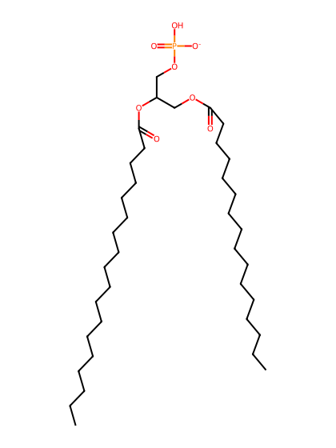
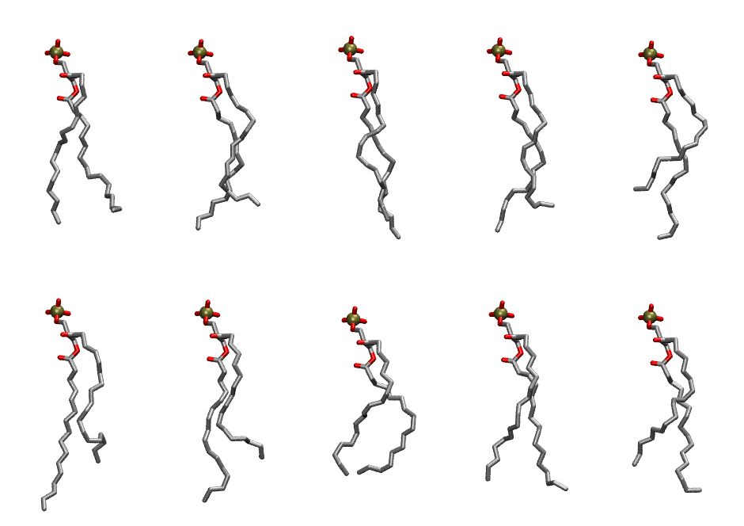

.. _lipid_gallery plpa:

PLPA
====

**1-palmitoyl-2-linoleoyl-Phosphatidic acid**

==============  ========================================
CHARMM resname  ``PLPA``
Net charge      -1.00
Atoms           114
Topology file   ``toppar_all36_lipid_miscellaneous.str``
Conformers      10 fluid
==============  ========================================

Structure
---------

Conformers
----------

The grid packer draws a conformer per lipid from this ensemble, so what the ensemble contains is what a built bilayer is made of. A leaflet declared ``phase: Lo`` generates an ordered ensemble when a build first needs it. All conformers are rendered at one shared scale.

===========  =============  ================  ================
Conformer    Head-tail (Å)  Max internal (Å)  Min chain extent
===========  =============  ================  ================
``PLPA-00``  13.19          22.32             0.68
``PLPA-01``  12.44          22.86             0.70
``PLPA-02``  14.59          25.02             0.80
``PLPA-03``  12.81          23.41             0.72
``PLPA-04``  10.48          23.86             0.61
``PLPA-05``  12.19          25.43             0.69
``PLPA-06``  11.45          24.32             0.65
``PLPA-07``  12.59          20.73             0.65
``PLPA-08``  14.03          24.22             0.77
``PLPA-09``  11.91          23.59             0.68
===========  =============  ================  ================

*Min chain extent* is how far the least-extended acyl chain descends below its own attachment carbon, as a fraction of that chain's all-trans contour; an all-trans chain scores 1.0, and a conformer under 0.25 is rejected at generation as folded.

Provenance
----------

How the ensemble was generated, read from the entry's own ``info.yaml``:

===================  ============
Setting              ``PLPA``
===================  ============
Sampler              ``mc``
Phase                none (fluid)
Trans bias           0.0
Chain order          0.200
MC seed              0
Chains               2
Cylinder APL         60.0 Ų
Cylinder inflation   1.9
Equilibration steps  20000
Decorrelation steps  3000
Max MC angle         30°
Radius scale         0.8
Axial bias           1.0
===================  ============
