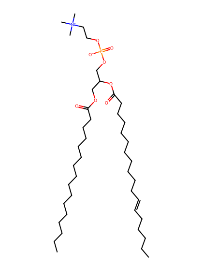
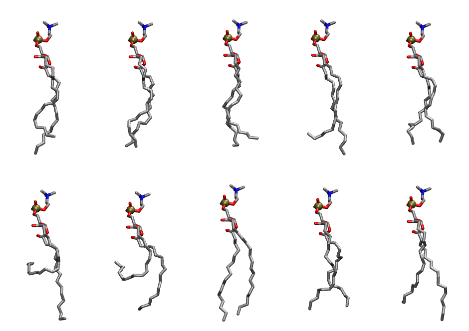

.. _lipid_gallery plpc:

PLPC
====

**1-palmitoyl-2-linoleoyl-Phosphatidylcholine**

==============  ========================================
CHARMM resname  ``PLPC``
Net charge      0.00
Atoms           132
Topology file   ``toppar_all36_lipid_miscellaneous.str``
Conformers      10 fluid
==============  ========================================

Structure
---------

Conformers
----------

The grid packer draws a conformer per lipid from this ensemble, so what the ensemble contains is what a built bilayer is made of. A leaflet declared ``phase: Lo`` generates an ordered ensemble when a build first needs it. All conformers are rendered at one shared scale.

===========  =============  ================  ================
Conformer    Head-tail (Å)  Max internal (Å)  Min chain extent
===========  =============  ================  ================
``PLPC-00``  13.29          26.85             0.71
``PLPC-01``  15.08          27.00             0.78
``PLPC-02``  13.93          27.23             0.72
``PLPC-03``  13.08          27.63             0.70
``PLPC-04``  14.15          25.21             0.75
``PLPC-05``  5.46           26.95             0.34
``PLPC-06``  4.74           24.23             0.31
``PLPC-07``  16.05          27.56             0.83
``PLPC-08``  13.84          25.33             0.71
``PLPC-09``  13.47          27.93             0.72
===========  =============  ================  ================

*Min chain extent* is how far the least-extended acyl chain descends below its own attachment carbon, as a fraction of that chain's all-trans contour; an all-trans chain scores 1.0, and a conformer under 0.25 is rejected at generation as folded.

Provenance
----------

How the ensemble was generated, read from the entry's own ``info.yaml``:

===================  ============
Setting              ``PLPC``
===================  ============
Sampler              ``mc``
Phase                none (fluid)
Trans bias           0.0
Chain order          0.205
MC seed              0
Chains               2
Cylinder APL         60.0 Ų
Cylinder inflation   1.9
Equilibration steps  20000
Decorrelation steps  3000
Max MC angle         30°
Radius scale         0.8
Axial bias           1.0
===================  ============
