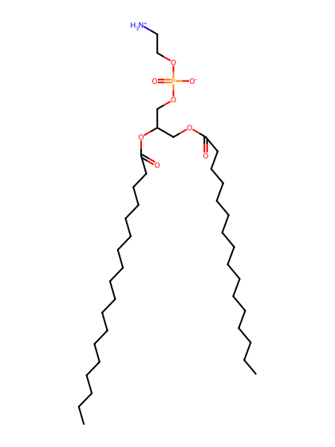
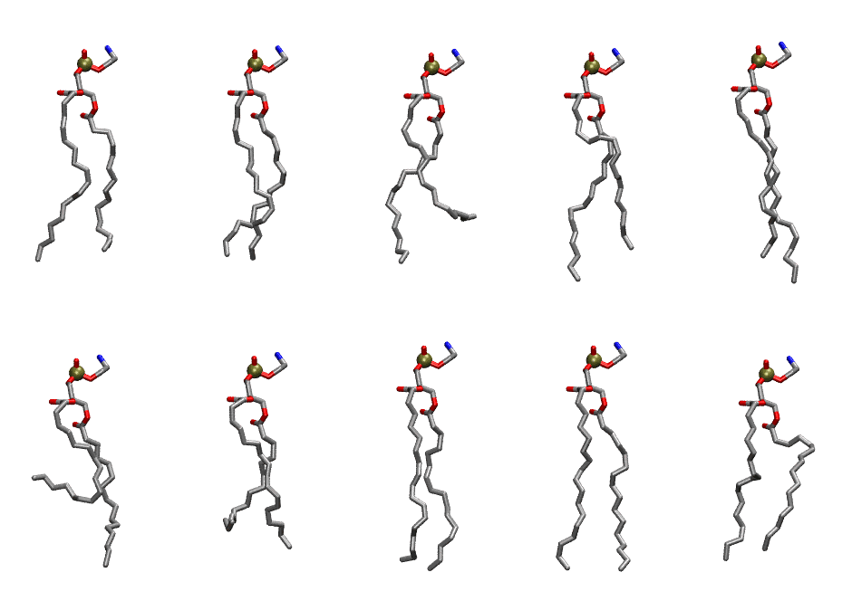

.. _lipid_gallery plpe:

PLPE
====

**1-palmitoyl-2-linoleoyl-Phosphatidylethanolamine**

==============  ========================================
CHARMM resname  ``PLPE``
Net charge      0.00
Atoms           123
Topology file   ``toppar_all36_lipid_miscellaneous.str``
Conformers      10 fluid
==============  ========================================

Structure
---------

Conformers
----------

The grid packer draws a conformer per lipid from this ensemble, so what the ensemble contains is what a built bilayer is made of. A leaflet declared ``phase: Lo`` generates an ordered ensemble when a build first needs it. All conformers are rendered at one shared scale.

===========  =============  ================  ================
Conformer    Head-tail (Å)  Max internal (Å)  Min chain extent
===========  =============  ================  ================
``PLPE-00``  14.04          25.35             0.73
``PLPE-01``  14.55          24.82             0.75
``PLPE-02``  10.23          25.48             0.58
``PLPE-03``  13.55          26.36             0.74
``PLPE-04``  15.10          26.59             0.81
``PLPE-05``  5.62           24.67             0.37
``PLPE-06``  10.49          22.19             0.54
``PLPE-07``  15.52          25.75             0.83
``PLPE-08``  16.37          26.59             0.85
``PLPE-09``  12.87          23.62             0.66
===========  =============  ================  ================

*Min chain extent* is how far the least-extended acyl chain descends below its own attachment carbon, as a fraction of that chain's all-trans contour; an all-trans chain scores 1.0, and a conformer under 0.25 is rejected at generation as folded.

Provenance
----------

How the ensemble was generated, read from the entry's own ``info.yaml``:

===================  ============
Setting              ``PLPE``
===================  ============
Sampler              ``mc``
Phase                none (fluid)
Trans bias           0.0
Chain order          0.216
MC seed              0
Chains               2
Cylinder APL         60.0 Ų
Cylinder inflation   1.9
Equilibration steps  20000
Decorrelation steps  3000
Max MC angle         30°
Radius scale         0.8
Axial bias           1.0
===================  ============
