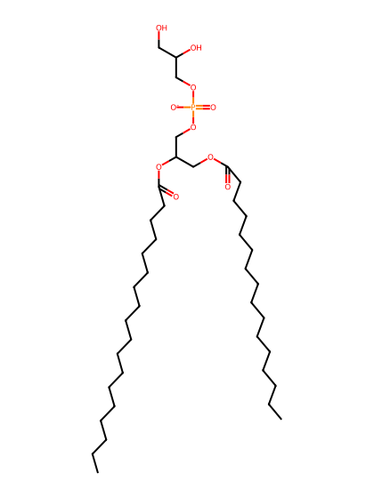
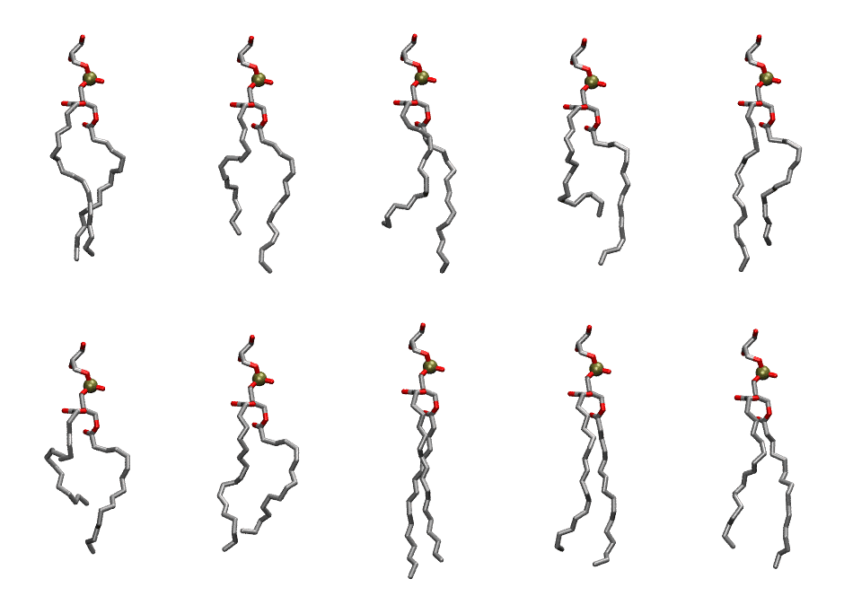

.. _lipid_gallery plpg:

PLPG
====

**1-palmitoyl-2-linoleoyl-Phosphatidylglycerol**

==============  ========================================
CHARMM resname  ``PLPG``
Net charge      -1.00
Atoms           125
Topology file   ``toppar_all36_lipid_miscellaneous.str``
Conformers      10 fluid
==============  ========================================

Structure
---------

Conformers
----------

The grid packer draws a conformer per lipid from this ensemble, so what the ensemble contains is what a built bilayer is made of. A leaflet declared ``phase: Lo`` generates an ordered ensemble when a build first needs it. All conformers are rendered at one shared scale.

===========  =============  ================  ================
Conformer    Head-tail (Å)  Max internal (Å)  Min chain extent
===========  =============  ================  ================
``PLPG-00``  14.63          26.03             0.78
``PLPG-01``  12.13          27.55             0.67
``PLPG-02``  11.22          27.77             0.63
``PLPG-03``  9.82           27.08             0.56
``PLPG-04``  13.45          27.92             0.69
``PLPG-05``  8.09           24.53             0.48
``PLPG-06``  11.99          25.59             0.61
``PLPG-07``  16.63          29.17             0.88
``PLPG-08``  15.16          27.63             0.81
``PLPG-09``  14.40          27.99             0.77
===========  =============  ================  ================

*Min chain extent* is how far the least-extended acyl chain descends below its own attachment carbon, as a fraction of that chain's all-trans contour; an all-trans chain scores 1.0, and a conformer under 0.25 is rejected at generation as folded.

Provenance
----------

How the ensemble was generated, read from the entry's own ``info.yaml``:

===================  ============
Setting              ``PLPG``
===================  ============
Sampler              ``mc``
Phase                none (fluid)
Trans bias           0.0
Chain order          0.215
MC seed              0
Chains               2
Cylinder APL         60.0 Ų
Cylinder inflation   1.9
Equilibration steps  20000
Decorrelation steps  3000
Max MC angle         30°
Radius scale         0.8
Axial bias           1.0
===================  ============
