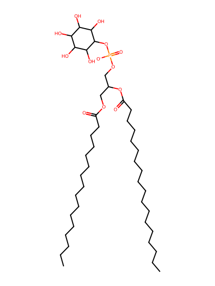
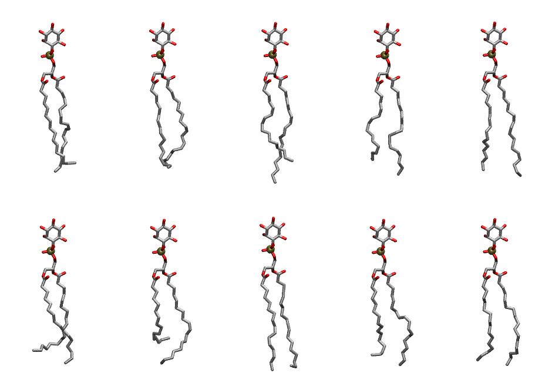

.. _lipid_gallery plpi:

PLPI
====

**1-Palmitoyl-2-Linoleoyl-inositol**

==============  ===================================
CHARMM resname  ``PLPI``
Net charge      -1.00
Atoms           135
Topology file   ``toppar_all36_lipid_inositol.str``
Conformers      10 fluid
==============  ===================================

Structure
---------

Conformers
----------

The grid packer draws a conformer per lipid from this ensemble, so what the ensemble contains is what a built bilayer is made of. A leaflet declared ``phase: Lo`` generates an ordered ensemble when a build first needs it. All conformers are rendered at one shared scale.

===========  =============  ================  ================
Conformer    Head-tail (Å)  Max internal (Å)  Min chain extent
===========  =============  ================  ================
``PLPI-00``  16.02          31.23             0.82
``PLPI-01``  16.66          30.49             0.78
``PLPI-02``  15.75          33.24             0.80
``PLPI-03``  15.17          31.46             0.77
``PLPI-04``  17.58          32.49             0.88
``PLPI-05``  14.43          29.72             0.68
``PLPI-06``  11.92          30.01             0.60
``PLPI-07``  17.76          31.62             0.83
``PLPI-08``  15.23          31.24             0.77
``PLPI-09``  16.34          30.61             0.81
===========  =============  ================  ================

*Min chain extent* is how far the least-extended acyl chain descends below its own attachment carbon, as a fraction of that chain's all-trans contour; an all-trans chain scores 1.0, and a conformer under 0.25 is rejected at generation as folded.

Provenance
----------

How the ensemble was generated, read from the entry's own ``info.yaml``:

===================  ============
Setting              ``PLPI``
===================  ============
Sampler              ``mc``
Phase                none (fluid)
Trans bias           0.0
Chain order          0.254
MC seed              0
Chains               2
Cylinder APL         60.0 Ų
Cylinder inflation   1.9
Equilibration steps  20000
Decorrelation steps  3000
Max MC angle         30°
Radius scale         0.8
Axial bias           1.0
===================  ============
