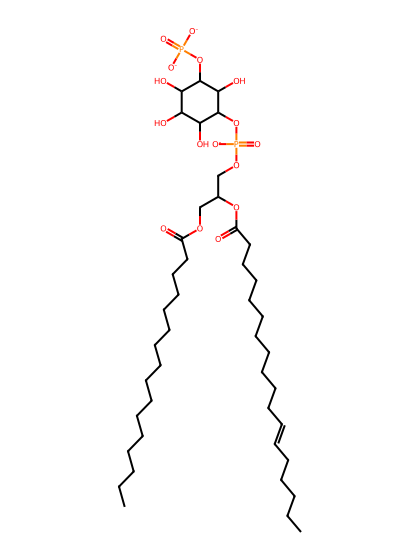
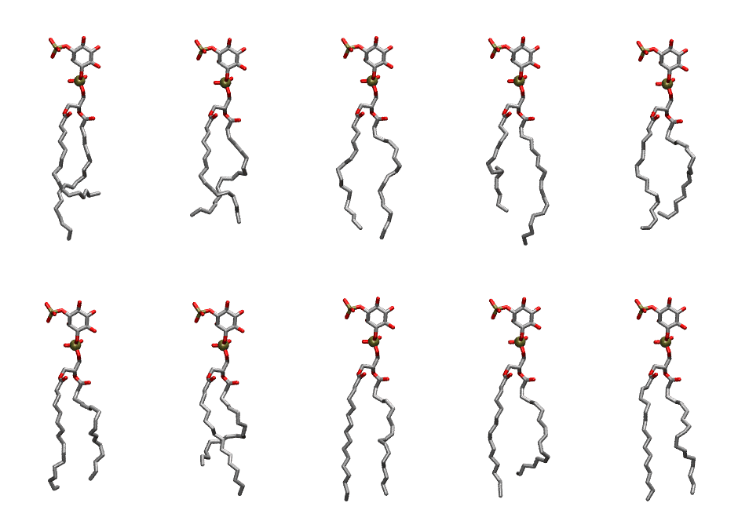

.. _lipid_gallery plpi13:

PLPI13
======

**1-Palmitoyl-2-Linoleoyl-inositol-(3)-phosphate (PIP1)**

==============  ===================================
CHARMM resname  ``PLPI13``
Net charge      -3.00
Atoms           138
Topology file   ``toppar_all36_lipid_inositol.str``
Conformers      10 fluid
==============  ===================================

Structure
---------

Conformers
----------

The grid packer draws a conformer per lipid from this ensemble, so what the ensemble contains is what a built bilayer is made of. A leaflet declared ``phase: Lo`` generates an ordered ensemble when a build first needs it. All conformers are rendered at one shared scale.

=============  =============  ================  ================
Conformer      Head-tail (Å)  Max internal (Å)  Min chain extent
=============  =============  ================  ================
``PLPI13-00``  10.90          30.80             0.58
``PLPI13-01``  13.80          27.89             0.64
``PLPI13-02``  15.92          30.59             0.80
``PLPI13-03``  13.38          31.91             0.71
``PLPI13-04``  13.32          29.24             0.61
``PLPI13-05``  13.98          29.17             0.64
``PLPI13-06``  11.90          29.39             0.55
``PLPI13-07``  16.69          31.32             0.77
``PLPI13-08``  13.66          30.14             0.63
``PLPI13-09``  16.50          30.78             0.76
=============  =============  ================  ================

*Min chain extent* is how far the least-extended acyl chain descends below its own attachment carbon, as a fraction of that chain's all-trans contour; an all-trans chain scores 1.0, and a conformer under 0.25 is rejected at generation as folded.

Provenance
----------

How the ensemble was generated, read from the entry's own ``info.yaml``:

===================  ============
Setting              ``PLPI13``
===================  ============
Sampler              ``mc``
Phase                none (fluid)
Trans bias           0.0
Chain order          0.203
MC seed              0
Chains               2
Cylinder APL         60.0 Ų
Cylinder inflation   1.9
Equilibration steps  20000
Decorrelation steps  3000
Max MC angle         30°
Radius scale         0.8
Axial bias           1.0
===================  ============
