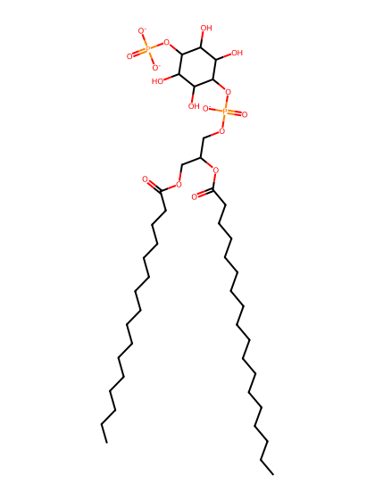
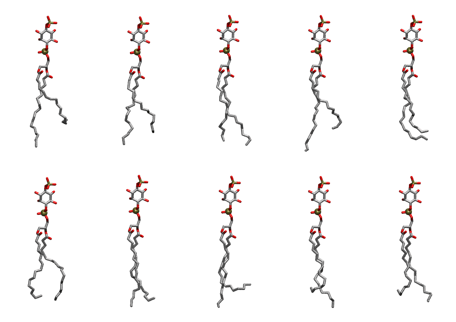

.. _lipid_gallery plpi14:

PLPI14
======

**1-Palmitoyl-2-Linolenoyl-inositol-(4)-phosphate (PIP1)**

==============  ===================================
CHARMM resname  ``PLPI14``
Net charge      -3.00
Atoms           138
Topology file   ``toppar_all36_lipid_inositol.str``
Conformers      10 fluid
==============  ===================================

Structure
---------

Conformers
----------

The grid packer draws a conformer per lipid from this ensemble, so what the ensemble contains is what a built bilayer is made of. A leaflet declared ``phase: Lo`` generates an ordered ensemble when a build first needs it. All conformers are rendered at one shared scale.

=============  =============  ================  ================
Conformer      Head-tail (Å)  Max internal (Å)  Min chain extent
=============  =============  ================  ================
``PLPI14-00``  11.11          32.04             0.63
``PLPI14-01``  13.04          31.49             0.73
``PLPI14-02``  15.45          32.37             0.78
``PLPI14-03``  12.47          33.69             0.70
``PLPI14-04``  13.16          31.36             0.72
``PLPI14-05``  13.76          30.81             0.70
``PLPI14-06``  14.87          31.84             0.71
``PLPI14-07``  11.39          32.37             0.55
``PLPI14-08``  12.17          32.77             0.68
``PLPI14-09``  12.78          31.10             0.71
=============  =============  ================  ================

*Min chain extent* is how far the least-extended acyl chain descends below its own attachment carbon, as a fraction of that chain's all-trans contour; an all-trans chain scores 1.0, and a conformer under 0.25 is rejected at generation as folded.

Provenance
----------

How the ensemble was generated, read from the entry's own ``info.yaml``:

===================  ============
Setting              ``PLPI14``
===================  ============
Sampler              ``mc``
Phase                none (fluid)
Trans bias           0.0
Chain order          0.201
MC seed              0
Chains               2
Cylinder APL         60.0 Ų
Cylinder inflation   1.9
Equilibration steps  20000
Decorrelation steps  3000
Max MC angle         30°
Radius scale         0.8
Axial bias           1.0
===================  ============
