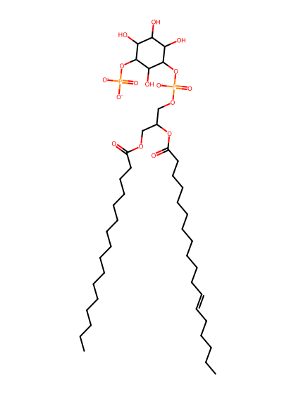
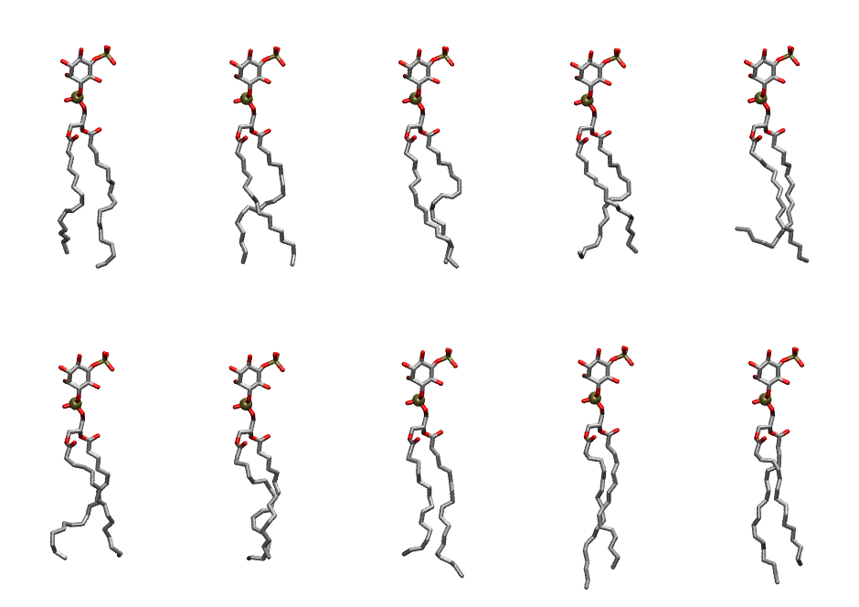

.. _lipid_gallery plpi15:

PLPI15
======

**1-Palmitoyl-2-Linoleoyl-inositol-(5)-phosphate (PIP1)**

==============  ===================================
CHARMM resname  ``PLPI15``
Net charge      -3.00
Atoms           138
Topology file   ``toppar_all36_lipid_inositol.str``
Conformers      10 fluid
==============  ===================================

Structure
---------

Conformers
----------

The grid packer draws a conformer per lipid from this ensemble, so what the ensemble contains is what a built bilayer is made of. A leaflet declared ``phase: Lo`` generates an ordered ensemble when a build first needs it. All conformers are rendered at one shared scale.

=============  =============  ================  ================
Conformer      Head-tail (Å)  Max internal (Å)  Min chain extent
=============  =============  ================  ================
``PLPI15-00``  14.96          30.10             0.76
``PLPI15-01``  16.06          29.85             0.76
``PLPI15-02``  16.07          29.94             0.76
``PLPI15-03``  14.50          28.36             0.69
``PLPI15-04``  11.81          29.62             0.56
``PLPI15-05``  14.54          28.50             0.70
``PLPI15-06``  14.72          28.89             0.70
``PLPI15-07``  14.86          30.80             0.75
``PLPI15-08``  16.81          32.46             0.85
``PLPI15-09``  16.24          31.95             0.82
=============  =============  ================  ================

*Min chain extent* is how far the least-extended acyl chain descends below its own attachment carbon, as a fraction of that chain's all-trans contour; an all-trans chain scores 1.0, and a conformer under 0.25 is rejected at generation as folded.

Provenance
----------

How the ensemble was generated, read from the entry's own ``info.yaml``:

===================  ============
Setting              ``PLPI15``
===================  ============
Sampler              ``mc``
Phase                none (fluid)
Trans bias           0.0
Chain order          0.208
MC seed              0
Chains               2
Cylinder APL         60.0 Ų
Cylinder inflation   1.9
Equilibration steps  20000
Decorrelation steps  3000
Max MC angle         30°
Radius scale         0.8
Axial bias           1.0
===================  ============
