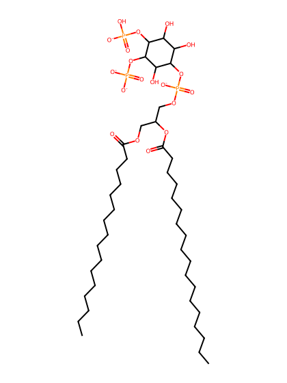
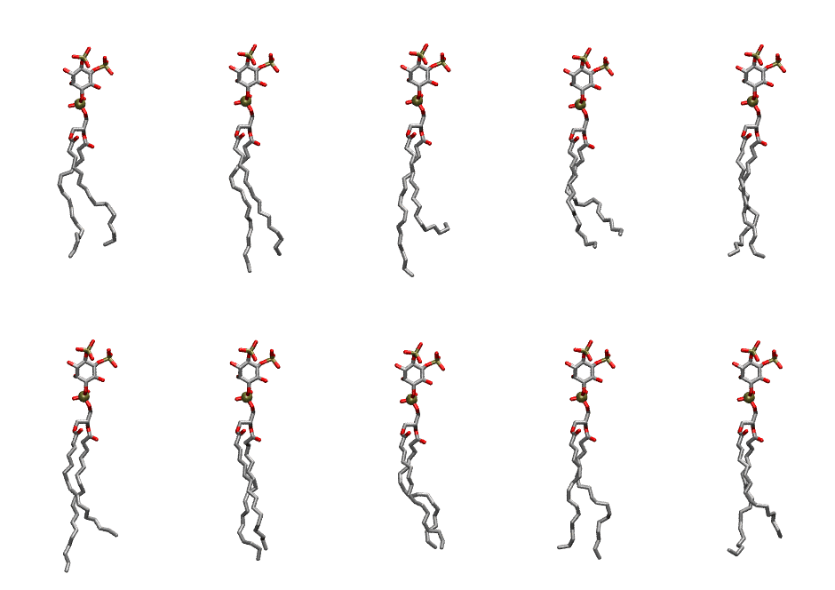

.. _lipid_gallery plpi24:

PLPI24
======

**1-Palmitoyl-2-Linoleoyl-inositol-(4,5)-bisphosphate (PIP2) with protonation on P4**

==============  ===================================
CHARMM resname  ``PLPI24``
Net charge      -4.00
Atoms           142
Topology file   ``toppar_all36_lipid_inositol.str``
Conformers      10 fluid
==============  ===================================

Structure
---------

Conformers
----------

The grid packer draws a conformer per lipid from this ensemble, so what the ensemble contains is what a built bilayer is made of. A leaflet declared ``phase: Lo`` generates an ordered ensemble when a build first needs it. All conformers are rendered at one shared scale.

=============  =============  ================  ================
Conformer      Head-tail (Å)  Max internal (Å)  Min chain extent
=============  =============  ================  ================
``PLPI24-00``  14.19          31.33             0.76
``PLPI24-01``  15.98          34.39             0.87
``PLPI24-02``  11.70          35.16             0.65
``PLPI24-03``  12.63          29.78             0.61
``PLPI24-04``  16.06          31.54             0.76
``PLPI24-05``  13.91          34.86             0.77
``PLPI24-06``  15.75          32.92             0.82
``PLPI24-07``  15.24          31.03             0.73
``PLPI24-08``  15.61          33.02             0.81
``PLPI24-09``  13.94          32.05             0.76
=============  =============  ================  ================

*Min chain extent* is how far the least-extended acyl chain descends below its own attachment carbon, as a fraction of that chain's all-trans contour; an all-trans chain scores 1.0, and a conformer under 0.25 is rejected at generation as folded.

Provenance
----------

How the ensemble was generated, read from the entry's own ``info.yaml``:

===================  ============
Setting              ``PLPI24``
===================  ============
Sampler              ``mc``
Phase                none (fluid)
Trans bias           0.0
Chain order          0.246
MC seed              0
Chains               2
Cylinder APL         60.0 Ų
Cylinder inflation   1.9
Equilibration steps  20000
Decorrelation steps  3000
Max MC angle         30°
Radius scale         0.8
Axial bias           1.0
===================  ============
