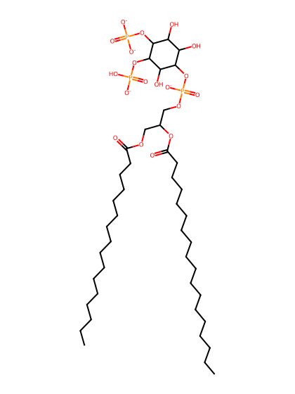
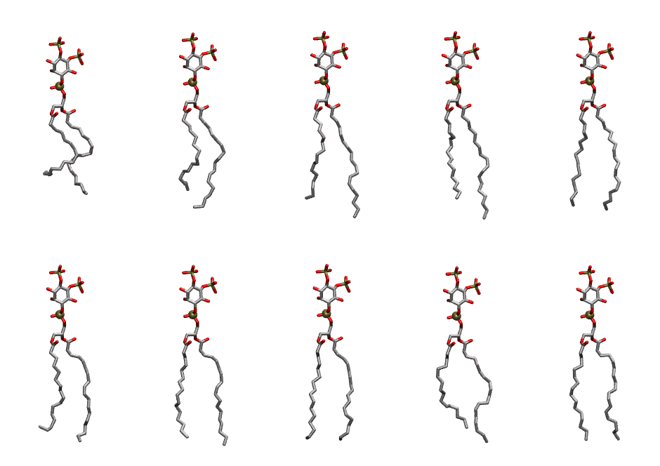

.. _lipid_gallery plpi25:

PLPI25
======

**1-Palmitoyl-2-Linoleoyl-inositol-(4,5)-bisphosphate (PIP2) with protonation on P5**

==============  ===================================
CHARMM resname  ``PLPI25``
Net charge      -4.00
Atoms           142
Topology file   ``toppar_all36_lipid_inositol.str``
Conformers      10 fluid
==============  ===================================

Structure
---------

Conformers
----------

The grid packer draws a conformer per lipid from this ensemble, so what the ensemble contains is what a built bilayer is made of. A leaflet declared ``phase: Lo`` generates an ordered ensemble when a build first needs it. All conformers are rendered at one shared scale.

=============  =============  ================  ================
Conformer      Head-tail (Å)  Max internal (Å)  Min chain extent
=============  =============  ================  ================
``PLPI25-00``  10.54          29.61             0.52
``PLPI25-01``  14.46          32.59             0.73
``PLPI25-02``  16.30          34.95             0.83
``PLPI25-03``  16.24          34.98             0.82
``PLPI25-04``  17.52          33.24             0.84
``PLPI25-05``  15.33          32.78             0.78
``PLPI25-06``  17.17          33.43             0.86
``PLPI25-07``  17.54          32.66             0.82
``PLPI25-08``  15.19          32.54             0.77
``PLPI25-09``  17.46          32.80             0.81
=============  =============  ================  ================

*Min chain extent* is how far the least-extended acyl chain descends below its own attachment carbon, as a fraction of that chain's all-trans contour; an all-trans chain scores 1.0, and a conformer under 0.25 is rejected at generation as folded.

Provenance
----------

How the ensemble was generated, read from the entry's own ``info.yaml``:

===================  ============
Setting              ``PLPI25``
===================  ============
Sampler              ``mc``
Phase                none (fluid)
Trans bias           0.0
Chain order          0.238
MC seed              0
Chains               2
Cylinder APL         60.0 Ų
Cylinder inflation   1.9
Equilibration steps  20000
Decorrelation steps  3000
Max MC angle         30°
Radius scale         0.8
Axial bias           1.0
===================  ============
