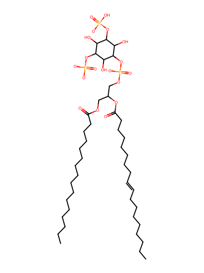
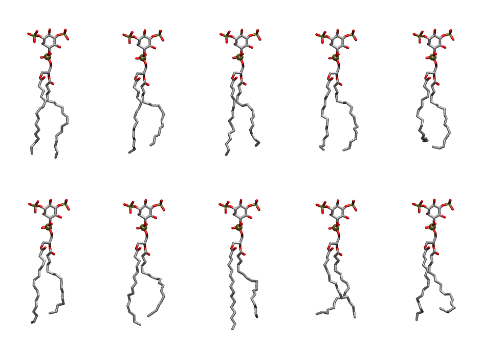

.. _lipid_gallery plpi2a:

PLPI2A
======

**1-Palmitoyl-2-Linoleoyl-inositol-(3,5)-bisphosphate (PIP2) with protonation on P3**

==============  ===================================
CHARMM resname  ``PLPI2A``
Net charge      -4.00
Atoms           142
Topology file   ``toppar_all36_lipid_inositol.str``
Conformers      10 fluid
==============  ===================================

Structure
---------

Conformers
----------

The grid packer draws a conformer per lipid from this ensemble, so what the ensemble contains is what a built bilayer is made of. A leaflet declared ``phase: Lo`` generates an ordered ensemble when a build first needs it. All conformers are rendered at one shared scale.

=============  =============  ================  ================
Conformer      Head-tail (Å)  Max internal (Å)  Min chain extent
=============  =============  ================  ================
``PLPI2A-00``  16.14          31.92             0.81
``PLPI2A-01``  13.94          30.09             0.67
``PLPI2A-02``  13.78          30.83             0.66
``PLPI2A-03``  15.05          29.76             0.73
``PLPI2A-04``  13.01          29.34             0.69
``PLPI2A-05``  13.67          30.58             0.66
``PLPI2A-06``  14.24          30.62             0.68
``PLPI2A-07``  14.48          31.49             0.69
``PLPI2A-08``  13.71          29.47             0.66
``PLPI2A-09``  12.60          29.43             0.61
=============  =============  ================  ================

*Min chain extent* is how far the least-extended acyl chain descends below its own attachment carbon, as a fraction of that chain's all-trans contour; an all-trans chain scores 1.0, and a conformer under 0.25 is rejected at generation as folded.

Provenance
----------

How the ensemble was generated, read from the entry's own ``info.yaml``:

===================  ============
Setting              ``PLPI2A``
===================  ============
Sampler              ``mc``
Phase                none (fluid)
Trans bias           0.0
Chain order          0.203
MC seed              0
Chains               2
Cylinder APL         60.0 Ų
Cylinder inflation   1.9
Equilibration steps  20000
Decorrelation steps  3000
Max MC angle         30°
Radius scale         0.8
Axial bias           1.0
===================  ============
