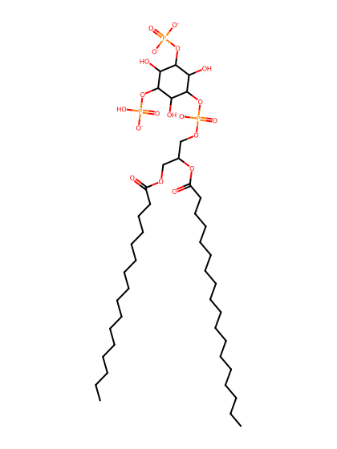
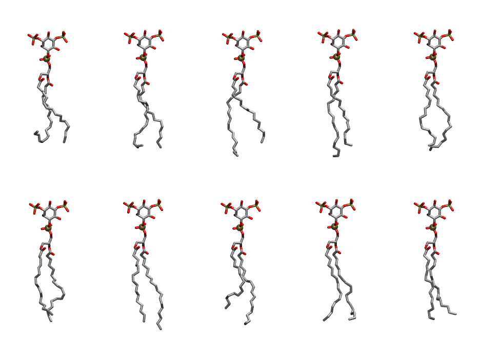

.. _lipid_gallery plpi2b:

PLPI2B
======

**1-Palmitoyl-2-Linoleoyl-inositol-(3,5)-bisphosphate (PIP2) with protonation on P5**

==============  ===================================
CHARMM resname  ``PLPI2B``
Net charge      -4.00
Atoms           142
Topology file   ``toppar_all36_lipid_inositol.str``
Conformers      10 fluid
==============  ===================================

Structure
---------

Conformers
----------

The grid packer draws a conformer per lipid from this ensemble, so what the ensemble contains is what a built bilayer is made of. A leaflet declared ``phase: Lo`` generates an ordered ensemble when a build first needs it. All conformers are rendered at one shared scale.

=============  =============  ================  ================
Conformer      Head-tail (Å)  Max internal (Å)  Min chain extent
=============  =============  ================  ================
``PLPI2B-00``  11.03          28.07             0.53
``PLPI2B-01``  14.66          29.69             0.70
``PLPI2B-02``  13.77          31.36             0.77
``PLPI2B-03``  14.80          32.34             0.83
``PLPI2B-04``  14.81          30.75             0.76
``PLPI2B-05``  14.32          30.38             0.76
``PLPI2B-06``  16.18          32.54             0.86
``PLPI2B-07``  12.86          31.08             0.72
``PLPI2B-08``  15.83          30.52             0.76
``PLPI2B-09``  14.38          29.94             0.69
=============  =============  ================  ================

*Min chain extent* is how far the least-extended acyl chain descends below its own attachment carbon, as a fraction of that chain's all-trans contour; an all-trans chain scores 1.0, and a conformer under 0.25 is rejected at generation as folded.

Provenance
----------

How the ensemble was generated, read from the entry's own ``info.yaml``:

===================  ============
Setting              ``PLPI2B``
===================  ============
Sampler              ``mc``
Phase                none (fluid)
Trans bias           0.0
Chain order          0.225
MC seed              0
Chains               2
Cylinder APL         60.0 Ų
Cylinder inflation   1.9
Equilibration steps  20000
Decorrelation steps  3000
Max MC angle         30°
Radius scale         0.8
Axial bias           1.0
===================  ============
