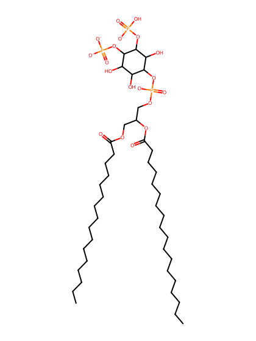
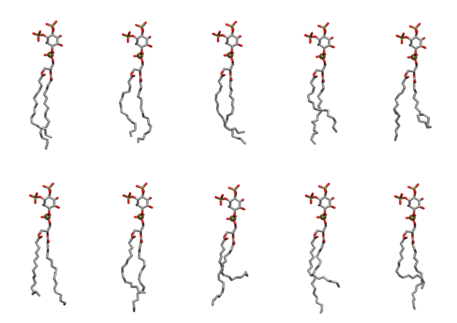

.. _lipid_gallery plpi2c:

PLPI2C
======

**1-Palmitoyl-2-Linoleoyl-inositol-(3,4)-trisphosphate (PIP2) with protonation on P3**

==============  ===================================
CHARMM resname  ``PLPI2C``
Net charge      -4.00
Atoms           142
Topology file   ``toppar_all36_lipid_inositol.str``
Conformers      10 fluid
==============  ===================================

Structure
---------

Conformers
----------

The grid packer draws a conformer per lipid from this ensemble, so what the ensemble contains is what a built bilayer is made of. A leaflet declared ``phase: Lo`` generates an ordered ensemble when a build first needs it. All conformers are rendered at one shared scale.

=============  =============  ================  ================
Conformer      Head-tail (Å)  Max internal (Å)  Min chain extent
=============  =============  ================  ================
``PLPI2C-00``  14.79          33.45             0.83
``PLPI2C-01``  14.20          31.82             0.75
``PLPI2C-02``  13.30          32.36             0.75
``PLPI2C-03``  12.91          32.20             0.73
``PLPI2C-04``  8.65           31.28             0.42
``PLPI2C-05``  13.83          32.00             0.77
``PLPI2C-06``  13.09          34.25             0.74
``PLPI2C-07``  7.35           32.10             0.44
``PLPI2C-08``  11.49          34.33             0.66
``PLPI2C-09``  11.72          33.05             0.67
=============  =============  ================  ================

*Min chain extent* is how far the least-extended acyl chain descends below its own attachment carbon, as a fraction of that chain's all-trans contour; an all-trans chain scores 1.0, and a conformer under 0.25 is rejected at generation as folded.

Provenance
----------

How the ensemble was generated, read from the entry's own ``info.yaml``:

===================  ============
Setting              ``PLPI2C``
===================  ============
Sampler              ``mc``
Phase                none (fluid)
Trans bias           0.0
Chain order          0.210
MC seed              0
Chains               2
Cylinder APL         60.0 Ų
Cylinder inflation   1.9
Equilibration steps  20000
Decorrelation steps  3000
Max MC angle         30°
Radius scale         0.8
Axial bias           1.0
===================  ============
