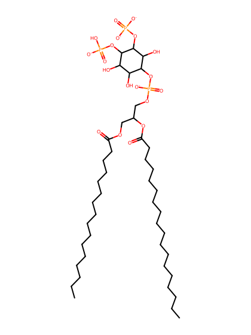
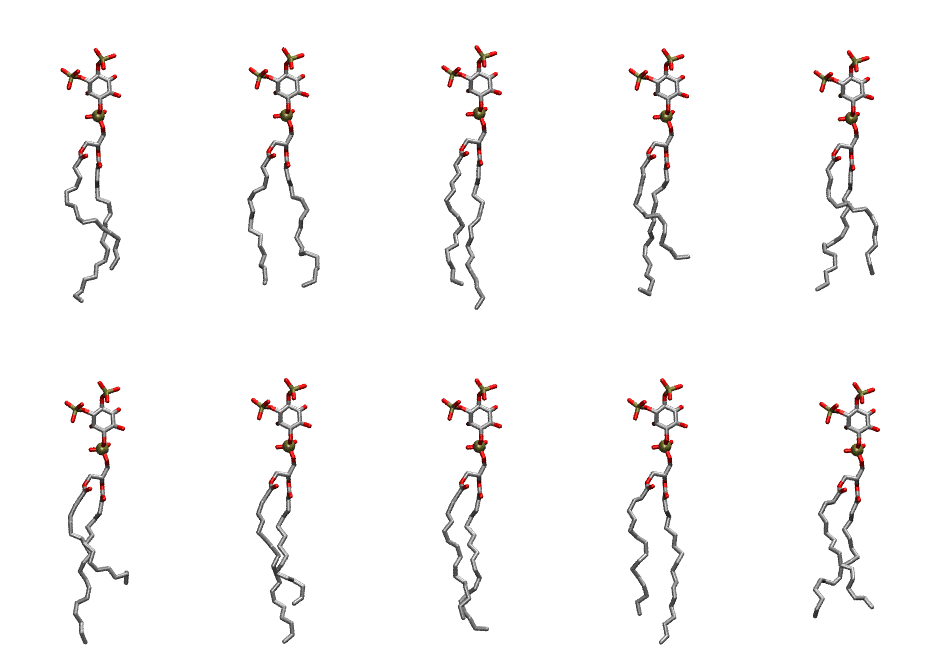

.. _lipid_gallery plpi2d:

PLPI2D
======

**1-Palmitoyl-2-Linoleoyl-inositol-(3,4)-bisphosphate (PIP2) with protonation on P4**

==============  ===================================
CHARMM resname  ``PLPI2D``
Net charge      -4.00
Atoms           142
Topology file   ``toppar_all36_lipid_inositol.str``
Conformers      10 fluid
==============  ===================================

Structure
---------

Conformers
----------

The grid packer draws a conformer per lipid from this ensemble, so what the ensemble contains is what a built bilayer is made of. A leaflet declared ``phase: Lo`` generates an ordered ensemble when a build first needs it. All conformers are rendered at one shared scale.

=============  =============  ================  ================
Conformer      Head-tail (Å)  Max internal (Å)  Min chain extent
=============  =============  ================  ================
``PLPI2D-00``  13.10          33.11             0.74
``PLPI2D-01``  15.08          31.56             0.74
``PLPI2D-02``  15.44          34.34             0.87
``PLPI2D-03``  11.58          32.60             0.66
``PLPI2D-04``  13.46          32.06             0.74
``PLPI2D-05``  10.73          34.44             0.62
``PLPI2D-06``  13.76          34.86             0.78
``PLPI2D-07``  15.55          33.09             0.81
``PLPI2D-08``  15.04          34.78             0.84
``PLPI2D-09``  13.72          31.70             0.71
=============  =============  ================  ================

*Min chain extent* is how far the least-extended acyl chain descends below its own attachment carbon, as a fraction of that chain's all-trans contour; an all-trans chain scores 1.0, and a conformer under 0.25 is rejected at generation as folded.

Provenance
----------

How the ensemble was generated, read from the entry's own ``info.yaml``:

===================  ============
Setting              ``PLPI2D``
===================  ============
Sampler              ``mc``
Phase                none (fluid)
Trans bias           0.0
Chain order          0.238
MC seed              0
Chains               2
Cylinder APL         60.0 Ų
Cylinder inflation   1.9
Equilibration steps  20000
Decorrelation steps  3000
Max MC angle         30°
Radius scale         0.8
Axial bias           1.0
===================  ============
