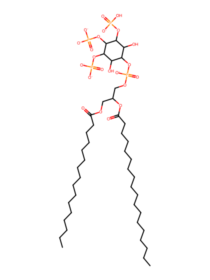
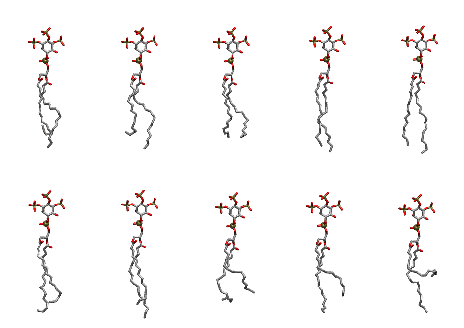

.. _lipid_gallery plpi33:

PLPI33
======

**1-Palmitoyl-2-Linoleoyl-inositol-(3,4,5)-trisphosphate (PIP3) with protonation on P3**

==============  ===================================
CHARMM resname  ``PLPI33``
Net charge      -6.00
Atoms           145
Topology file   ``toppar_all36_lipid_inositol.str``
Conformers      10 fluid
==============  ===================================

Structure
---------

Conformers
----------

The grid packer draws a conformer per lipid from this ensemble, so what the ensemble contains is what a built bilayer is made of. A leaflet declared ``phase: Lo`` generates an ordered ensemble when a build first needs it. All conformers are rendered at one shared scale.

=============  =============  ================  ================
Conformer      Head-tail (Å)  Max internal (Å)  Min chain extent
=============  =============  ================  ================
``PLPI33-00``  10.93          32.12             0.53
``PLPI33-01``  12.54          33.14             0.71
``PLPI33-02``  13.85          30.24             0.66
``PLPI33-03``  16.42          33.86             0.85
``PLPI33-04``  16.33          34.58             0.87
``PLPI33-05``  14.37          33.08             0.79
``PLPI33-06``  15.05          34.36             0.84
``PLPI33-07``  11.33          30.06             0.63
``PLPI33-08``  12.29          32.51             0.70
``PLPI33-09``  6.41           32.19             0.39
=============  =============  ================  ================

*Min chain extent* is how far the least-extended acyl chain descends below its own attachment carbon, as a fraction of that chain's all-trans contour; an all-trans chain scores 1.0, and a conformer under 0.25 is rejected at generation as folded.

Provenance
----------

How the ensemble was generated, read from the entry's own ``info.yaml``:

===================  ============
Setting              ``PLPI33``
===================  ============
Sampler              ``mc``
Phase                none (fluid)
Trans bias           0.0
Chain order          0.213
MC seed              0
Chains               2
Cylinder APL         60.0 Ų
Cylinder inflation   1.9
Equilibration steps  20000
Decorrelation steps  3000
Max MC angle         30°
Radius scale         0.8
Axial bias           1.0
===================  ============
