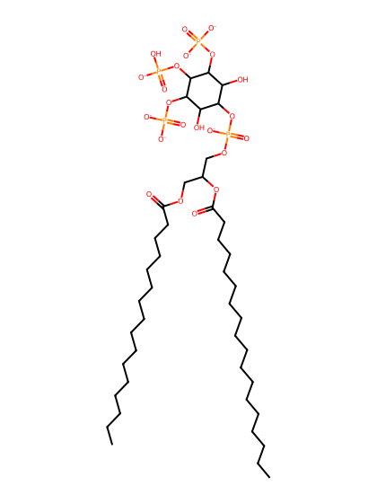
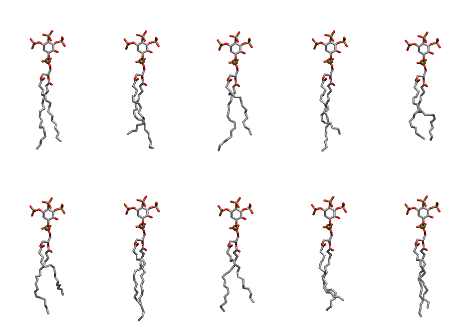

.. _lipid_gallery plpi34:

PLPI34
======

**1-Palmitoyl-2-Linoleoyl-inositol-(3,4,5)-trisphosphate (PIP3) with protonation on P4**

==============  ===================================
CHARMM resname  ``PLPI34``
Net charge      -6.00
Atoms           145
Topology file   ``toppar_all36_lipid_inositol.str``
Conformers      10 fluid
==============  ===================================

Structure
---------

Conformers
----------

The grid packer draws a conformer per lipid from this ensemble, so what the ensemble contains is what a built bilayer is made of. A leaflet declared ``phase: Lo`` generates an ordered ensemble when a build first needs it. All conformers are rendered at one shared scale.

=============  =============  ================  ================
Conformer      Head-tail (Å)  Max internal (Å)  Min chain extent
=============  =============  ================  ================
``PLPI34-00``  15.20          32.91             0.82
``PLPI34-01``  13.26          32.47             0.75
``PLPI34-02``  13.06          33.17             0.74
``PLPI34-03``  13.15          33.48             0.75
``PLPI34-04``  14.15          30.68             0.69
``PLPI34-05``  11.54          32.37             0.66
``PLPI34-06``  14.58          34.41             0.82
``PLPI34-07``  13.61          31.81             0.76
``PLPI34-08``  13.31          31.79             0.76
``PLPI34-09``  15.53          33.46             0.85
=============  =============  ================  ================

*Min chain extent* is how far the least-extended acyl chain descends below its own attachment carbon, as a fraction of that chain's all-trans contour; an all-trans chain scores 1.0, and a conformer under 0.25 is rejected at generation as folded.

Provenance
----------

How the ensemble was generated, read from the entry's own ``info.yaml``:

===================  ============
Setting              ``PLPI34``
===================  ============
Sampler              ``mc``
Phase                none (fluid)
Trans bias           0.0
Chain order          0.221
MC seed              0
Chains               2
Cylinder APL         60.0 Ų
Cylinder inflation   1.9
Equilibration steps  20000
Decorrelation steps  3000
Max MC angle         30°
Radius scale         0.8
Axial bias           1.0
===================  ============
