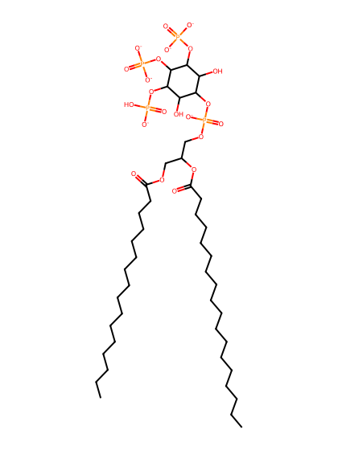
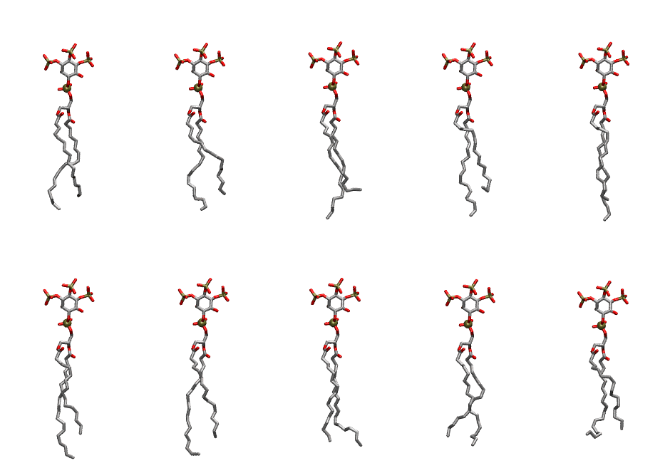

.. _lipid_gallery plpi35:

PLPI35
======

**1-Palmitoyl-2-Linoleoyl-inositol-(3,4,5)-trisphosphate (PIP3) with protonation on P5**

==============  ===================================
CHARMM resname  ``PLPI35``
Net charge      -6.00
Atoms           145
Topology file   ``toppar_all36_lipid_inositol.str``
Conformers      10 fluid
==============  ===================================

Structure
---------

Conformers
----------

The grid packer draws a conformer per lipid from this ensemble, so what the ensemble contains is what a built bilayer is made of. A leaflet declared ``phase: Lo`` generates an ordered ensemble when a build first needs it. All conformers are rendered at one shared scale.

=============  =============  ================  ================
Conformer      Head-tail (Å)  Max internal (Å)  Min chain extent
=============  =============  ================  ================
``PLPI35-00``  13.78          31.77             0.77
``PLPI35-01``  13.52          31.95             0.76
``PLPI35-02``  13.00          34.05             0.74
``PLPI35-03``  12.37          33.23             0.70
``PLPI35-04``  14.79          34.43             0.83
``PLPI35-05``  14.31          34.60             0.80
``PLPI35-06``  15.00          34.15             0.84
``PLPI35-07``  15.72          32.42             0.79
``PLPI35-08``  14.60          31.88             0.78
``PLPI35-09``  12.96          30.14             0.67
=============  =============  ================  ================

*Min chain extent* is how far the least-extended acyl chain descends below its own attachment carbon, as a fraction of that chain's all-trans contour; an all-trans chain scores 1.0, and a conformer under 0.25 is rejected at generation as folded.

Provenance
----------

How the ensemble was generated, read from the entry's own ``info.yaml``:

===================  ============
Setting              ``PLPI35``
===================  ============
Sampler              ``mc``
Phase                none (fluid)
Trans bias           0.0
Chain order          0.233
MC seed              0
Chains               2
Cylinder APL         60.0 Ų
Cylinder inflation   1.9
Equilibration steps  20000
Decorrelation steps  3000
Max MC angle         30°
Radius scale         0.8
Axial bias           1.0
===================  ============
