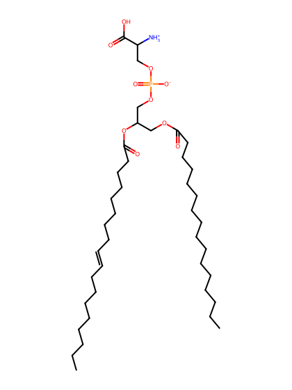
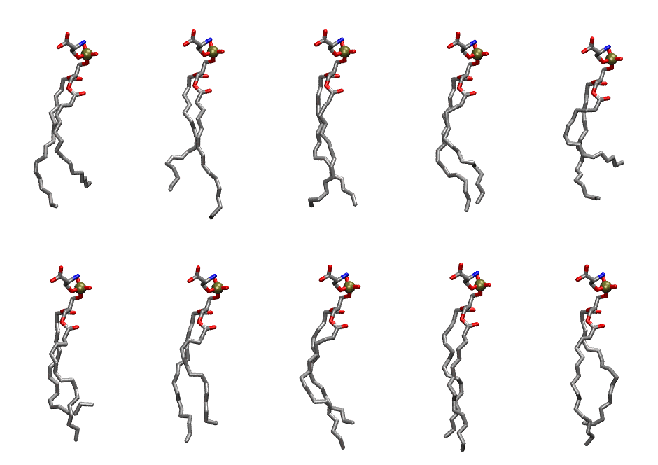

.. _lipid_gallery plps:

PLPS
====

**1-palmitoyl-2-linoleoyl-Phosphatidylserine**

==============  ========================================
CHARMM resname  ``PLPS``
Net charge      -1.00
Atoms           125
Topology file   ``toppar_all36_lipid_miscellaneous.str``
Conformers      10 fluid
==============  ========================================

Structure
---------

Conformers
----------

The grid packer draws a conformer per lipid from this ensemble, so what the ensemble contains is what a built bilayer is made of. A leaflet declared ``phase: Lo`` generates an ordered ensemble when a build first needs it. All conformers are rendered at one shared scale.

===========  =============  ================  ================
Conformer    Head-tail (Å)  Max internal (Å)  Min chain extent
===========  =============  ================  ================
``PLPS-00``  12.29          25.63             0.63
``PLPS-01``  13.52          26.79             0.72
``PLPS-02``  15.56          25.94             0.81
``PLPS-03``  14.99          26.32             0.77
``PLPS-04``  8.82           23.83             0.45
``PLPS-05``  10.60          24.32             0.58
``PLPS-06``  13.09          25.22             0.68
``PLPS-07``  13.23          27.22             0.68
``PLPS-08``  15.35          26.69             0.80
``PLPS-09``  13.30          25.72             0.71
===========  =============  ================  ================

*Min chain extent* is how far the least-extended acyl chain descends below its own attachment carbon, as a fraction of that chain's all-trans contour; an all-trans chain scores 1.0, and a conformer under 0.25 is rejected at generation as folded.

Provenance
----------

How the ensemble was generated, read from the entry's own ``info.yaml``:

===================  ============
Setting              ``PLPS``
===================  ============
Sampler              ``mc``
Phase                none (fluid)
Trans bias           0.0
Chain order          0.216
MC seed              0
Chains               2
Cylinder APL         60.0 Ų
Cylinder inflation   1.9
Equilibration steps  20000
Decorrelation steps  3000
Max MC angle         30°
Radius scale         0.8
Axial bias           1.0
===================  ============
