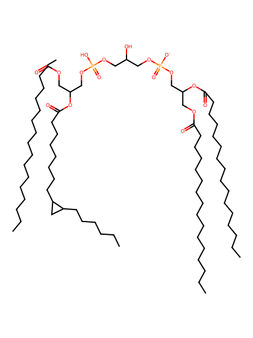
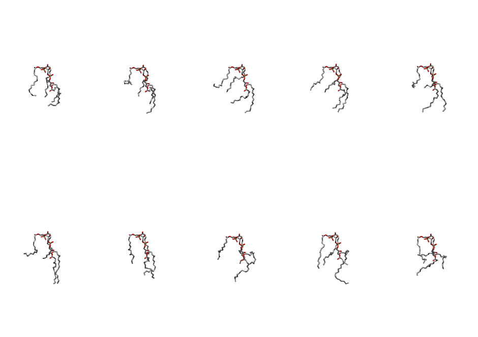
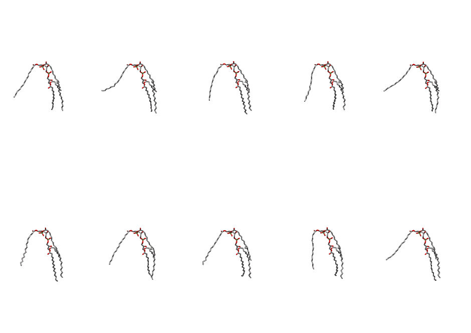

.. _lipid_gallery pmcl1:

PMCL1
=====

**(PMPG + DPPG) Cardiolipin with head group charge = -1**

==============  ===========================================
CHARMM resname  ``PMCL1``
Net charge      -1.00
Atoms           234
Topology file   ``toppar_all36_lipid_cardiolipin.str``
Conformers      10 fluid, 10 liquid-ordered (``PMCL1__Lo``)
==============  ===========================================

Structure
---------

Conformers
----------

The grid packer draws a conformer per lipid from an ensemble, so what the ensemble contains is what a built bilayer is made of. PMCL1 ships two: a fluid one, used by default, and a liquid-ordered one, used for a leaflet declared ``phase: Lo``. All conformers on this page are rendered at one shared scale.

Fluid (``PMCL1``)
~~~~~~~~~~~~~~~~~

============  =============  ================  ================
Conformer     Head-tail (Å)  Max internal (Å)  Min chain extent
============  =============  ================  ================
``PMCL1-00``  0.14           24.46             0.31
``PMCL1-01``  0.14           26.10             0.31
``PMCL1-02``  0.14           25.20             0.25
``PMCL1-03``  0.14           24.75             0.45
``PMCL1-04``  0.14           26.41             0.46
``PMCL1-05``  0.11           28.16             0.41
``PMCL1-06``  0.14           28.48             0.48
``PMCL1-07``  0.14           26.86             0.26
``PMCL1-08``  0.14           27.58             0.31
``PMCL1-09``  0.06           25.57             0.38
============  =============  ================  ================

Liquid-ordered (``PMCL1__Lo``)
~~~~~~~~~~~~~~~~~~~~~~~~~~~~~~

============  =============  ================  ================
Conformer     Head-tail (Å)  Max internal (Å)  Min chain extent
============  =============  ================  ================
``PMCL1-00``  0.14           30.56             0.48
``PMCL1-01``  0.14           31.34             0.46
``PMCL1-02``  0.14           31.64             0.46
``PMCL1-03``  0.14           30.58             0.47
``PMCL1-04``  0.14           31.34             0.46
``PMCL1-05``  0.14           31.68             0.49
``PMCL1-06``  0.14           31.06             0.48
``PMCL1-07``  0.14           30.41             0.44
``PMCL1-08``  0.14           30.50             0.46
``PMCL1-09``  0.14           31.74             0.48
============  =============  ================  ================

*Min chain extent* is how far the least-extended acyl chain descends below its own attachment carbon, as a fraction of that chain's all-trans contour; an all-trans chain scores 1.0, and a conformer under 0.25 is rejected at generation as folded.

Provenance
----------

How each ensemble was generated, read from the entry's own ``info.yaml``:

===================  ============  =============
Setting              ``PMCL1``     ``PMCL1__Lo``
===================  ============  =============
Sampler              ``mc``        ``mc``
Phase                none (fluid)  Lo
Trans bias           0.0           40.0
Chain order          0.093         0.174
MC seed              0             0
Chains               5             5
Cylinder APL         150.0 Ų      150.0 Ų
Cylinder inflation   1.9           1.9
Equilibration steps  20000         20000
Decorrelation steps  3000          3000
Max MC angle         30°           30°
Radius scale         0.8           0.8
Axial bias           1.0           1.0
===================  ============  =============
