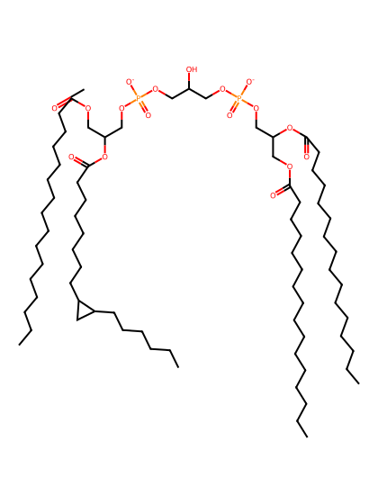
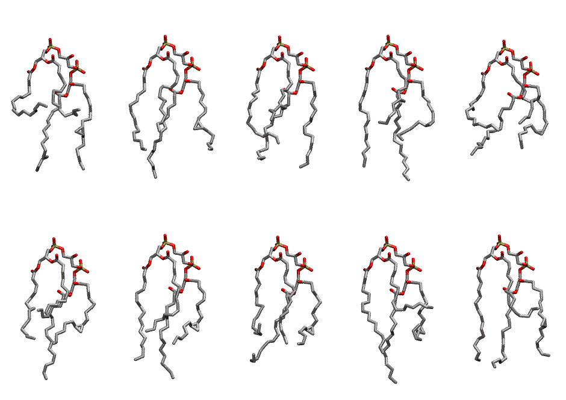
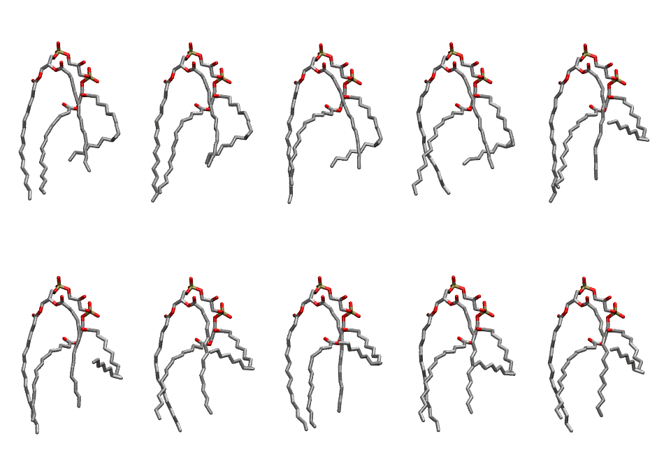

.. _lipid_gallery pmcl2:

PMCL2
=====

**(PMPG + DPPG) Cardiolipin with head group charge = -2**

==============  ===========================================
CHARMM resname  ``PMCL2``
Net charge      -2.00
Atoms           233
Topology file   ``toppar_all36_lipid_cardiolipin.str``
Conformers      10 fluid, 10 liquid-ordered (``PMCL2__Lo``)
==============  ===========================================

Structure
---------

Conformers
----------

The grid packer draws a conformer per lipid from an ensemble, so what the ensemble contains is what a built bilayer is made of. PMCL2 ships two: a fluid one, used by default, and a liquid-ordered one, used for a leaflet declared ``phase: Lo``. All conformers on this page are rendered at one shared scale.

Fluid (``PMCL2``)
~~~~~~~~~~~~~~~~~

============  =============  ================  ================
Conformer     Head-tail (Å)  Max internal (Å)  Min chain extent
============  =============  ================  ================
``PMCL2-00``  0.28           25.89             0.33
``PMCL2-01``  0.28           27.06             0.44
``PMCL2-02``  0.28           25.65             0.47
``PMCL2-03``  0.28           27.72             0.40
``PMCL2-04``  0.28           23.48             0.44
``PMCL2-05``  0.28           27.21             0.44
``PMCL2-06``  0.28           27.44             0.46
``PMCL2-07``  0.28           25.12             0.48
``PMCL2-08``  0.28           28.30             0.47
``PMCL2-09``  0.28           26.36             0.41
============  =============  ================  ================

Liquid-ordered (``PMCL2__Lo``)
~~~~~~~~~~~~~~~~~~~~~~~~~~~~~~

============  =============  ================  ================
Conformer     Head-tail (Å)  Max internal (Å)  Min chain extent
============  =============  ================  ================
``PMCL2-00``  0.28           27.48             0.33
``PMCL2-01``  0.28           27.02             0.31
``PMCL2-02``  0.28           26.75             0.36
``PMCL2-03``  0.28           26.86             0.38
``PMCL2-04``  0.28           26.59             0.34
``PMCL2-05``  0.28           26.31             0.38
``PMCL2-06``  0.28           26.20             0.30
``PMCL2-07``  0.28           27.27             0.26
``PMCL2-08``  0.28           26.30             0.35
``PMCL2-09``  0.28           26.18             0.33
============  =============  ================  ================

*Min chain extent* is how far the least-extended acyl chain descends below its own attachment carbon, as a fraction of that chain's all-trans contour; an all-trans chain scores 1.0, and a conformer under 0.25 is rejected at generation as folded.

Provenance
----------

How each ensemble was generated, read from the entry's own ``info.yaml``:

===================  ============  =============
Setting              ``PMCL2``     ``PMCL2__Lo``
===================  ============  =============
Sampler              ``mc``        ``mc``
Phase                none (fluid)  Lo
Trans bias           0.0           40.0
Chain order          0.148         0.190
MC seed              0             0
Chains               5             5
Cylinder APL         150.0 Ų      150.0 Ų
Cylinder inflation   1.9           1.9
Equilibration steps  20000         20000
Decorrelation steps  3000          3000
Max MC angle         30°           30°
Radius scale         0.8           0.8
Axial bias           1.0           1.0
===================  ============  =============
