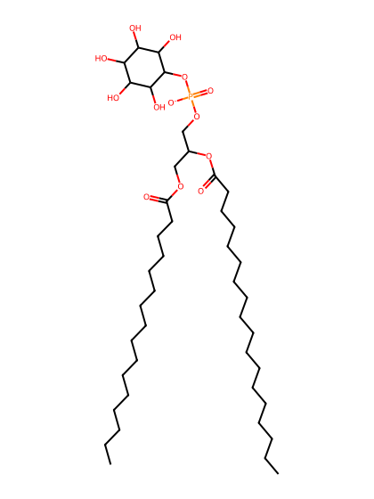
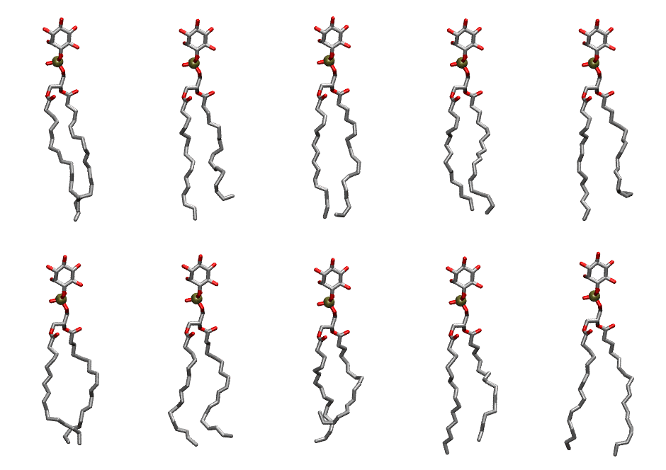

.. _lipid_gallery pnpi:

PNPI
====

**1-Palmitoyl-2-Linolenoyl-inositol**

==============  ===================================
CHARMM resname  ``PNPI``
Net charge      -1.00
Atoms           133
Topology file   ``toppar_all36_lipid_inositol.str``
Conformers      10 fluid
==============  ===================================

Structure
---------

Conformers
----------

The grid packer draws a conformer per lipid from this ensemble, so what the ensemble contains is what a built bilayer is made of. A leaflet declared ``phase: Lo`` generates an ordered ensemble when a build first needs it. All conformers are rendered at one shared scale.

===========  =============  ================  ================
Conformer    Head-tail (Å)  Max internal (Å)  Min chain extent
===========  =============  ================  ================
``PNPI-00``  16.51          31.41             0.84
``PNPI-01``  14.17          29.92             0.67
``PNPI-02``  17.22          30.82             0.81
``PNPI-03``  16.14          29.80             0.78
``PNPI-04``  13.74          30.47             0.65
``PNPI-05``  15.62          29.07             0.73
``PNPI-06``  14.83          28.74             0.70
``PNPI-07``  10.93          28.66             0.52
``PNPI-08``  15.05          29.83             0.71
``PNPI-09``  16.99          30.62             0.84
===========  =============  ================  ================

*Min chain extent* is how far the least-extended acyl chain descends below its own attachment carbon, as a fraction of that chain's all-trans contour; an all-trans chain scores 1.0, and a conformer under 0.25 is rejected at generation as folded.

Provenance
----------

How the ensemble was generated, read from the entry's own ``info.yaml``:

===================  ============
Setting              ``PNPI``
===================  ============
Sampler              ``mc``
Phase                none (fluid)
Trans bias           0.0
Chain order          0.219
MC seed              0
Chains               2
Cylinder APL         60.0 Ų
Cylinder inflation   1.9
Equilibration steps  20000
Decorrelation steps  3000
Max MC angle         30°
Radius scale         0.8
Axial bias           1.0
===================  ============
