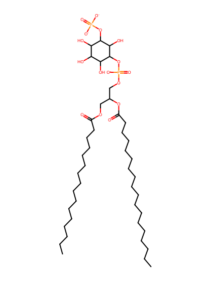
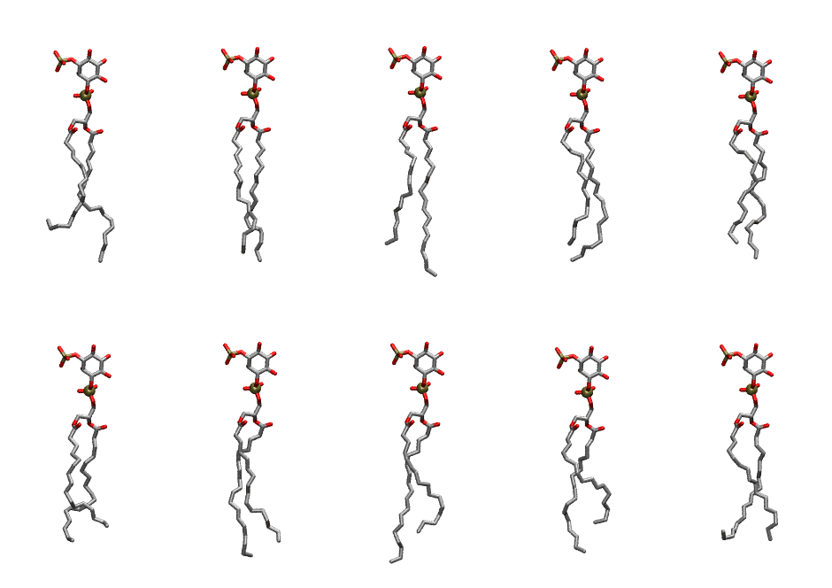

.. _lipid_gallery pnpi13:

PNPI13
======

**1-Palmitoyl-2-Linolenoyl-inositol-(3)-phosphate (PIP1)**

==============  ===================================
CHARMM resname  ``PNPI13``
Net charge      -3.00
Atoms           136
Topology file   ``toppar_all36_lipid_inositol.str``
Conformers      10 fluid
==============  ===================================

Structure
---------

Conformers
----------

The grid packer draws a conformer per lipid from this ensemble, so what the ensemble contains is what a built bilayer is made of. A leaflet declared ``phase: Lo`` generates an ordered ensemble when a build first needs it. All conformers are rendered at one shared scale.

=============  =============  ================  ================
Conformer      Head-tail (Å)  Max internal (Å)  Min chain extent
=============  =============  ================  ================
``PNPI13-00``  12.47          31.05             0.64
``PNPI13-01``  17.16          31.54             0.83
``PNPI13-02``  16.07          33.63             0.83
``PNPI13-03``  15.88          31.32             0.82
``PNPI13-04``  15.36          30.34             0.79
``PNPI13-05``  13.86          29.04             0.72
``PNPI13-06``  16.29          31.79             0.84
``PNPI13-07``  15.01          32.81             0.78
``PNPI13-08``  13.16          30.49             0.68
``PNPI13-09``  14.84          29.17             0.67
=============  =============  ================  ================

*Min chain extent* is how far the least-extended acyl chain descends below its own attachment carbon, as a fraction of that chain's all-trans contour; an all-trans chain scores 1.0, and a conformer under 0.25 is rejected at generation as folded.

Provenance
----------

How the ensemble was generated, read from the entry's own ``info.yaml``:

===================  ============
Setting              ``PNPI13``
===================  ============
Sampler              ``mc``
Phase                none (fluid)
Trans bias           0.0
Chain order          0.234
MC seed              0
Chains               2
Cylinder APL         60.0 Ų
Cylinder inflation   1.9
Equilibration steps  20000
Decorrelation steps  3000
Max MC angle         30°
Radius scale         0.8
Axial bias           1.0
===================  ============
