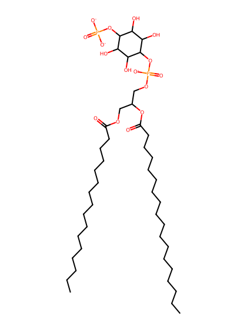
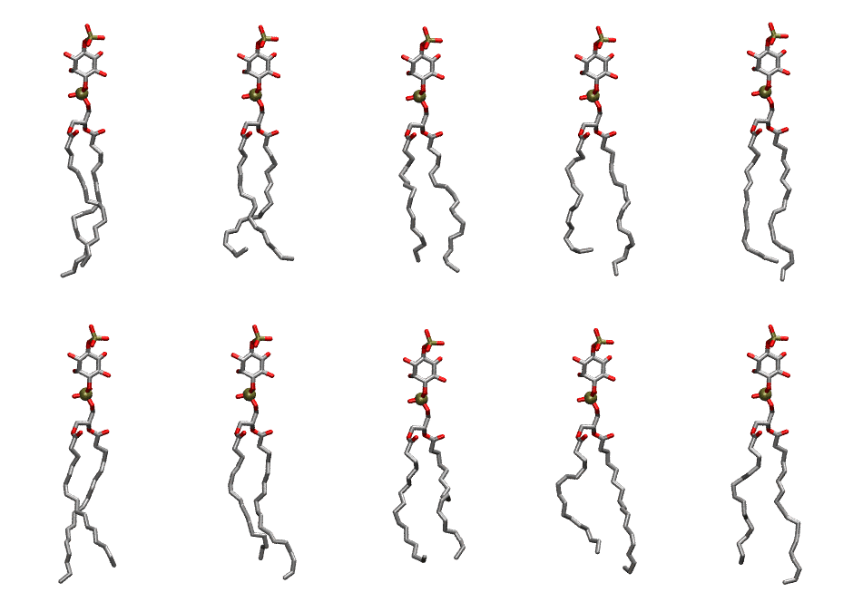

.. _lipid_gallery pnpi14:

PNPI14
======

**1-Palmitoyl-2-Linolenoyl-inositol-(4)-phosphate (PIP1)**

==============  ===================================
CHARMM resname  ``PNPI14``
Net charge      -3.00
Atoms           136
Topology file   ``toppar_all36_lipid_inositol.str``
Conformers      10 fluid
==============  ===================================

Structure
---------

Conformers
----------

The grid packer draws a conformer per lipid from this ensemble, so what the ensemble contains is what a built bilayer is made of. A leaflet declared ``phase: Lo`` generates an ordered ensemble when a build first needs it. All conformers are rendered at one shared scale.

=============  =============  ================  ================
Conformer      Head-tail (Å)  Max internal (Å)  Min chain extent
=============  =============  ================  ================
``PNPI14-00``  16.69          32.96             0.82
``PNPI14-01``  14.56          30.21             0.66
``PNPI14-02``  15.74          31.47             0.78
``PNPI14-03``  14.48          31.81             0.73
``PNPI14-04``  16.41          32.86             0.83
``PNPI14-05``  16.64          33.27             0.84
``PNPI14-06``  15.71          32.91             0.79
``PNPI14-07``  14.99          29.89             0.69
``PNPI14-08``  14.50          31.76             0.73
``PNPI14-09``  16.30          33.28             0.83
=============  =============  ================  ================

*Min chain extent* is how far the least-extended acyl chain descends below its own attachment carbon, as a fraction of that chain's all-trans contour; an all-trans chain scores 1.0, and a conformer under 0.25 is rejected at generation as folded.

Provenance
----------

How the ensemble was generated, read from the entry's own ``info.yaml``:

===================  ============
Setting              ``PNPI14``
===================  ============
Sampler              ``mc``
Phase                none (fluid)
Trans bias           0.0
Chain order          0.222
MC seed              0
Chains               2
Cylinder APL         60.0 Ų
Cylinder inflation   1.9
Equilibration steps  20000
Decorrelation steps  3000
Max MC angle         30°
Radius scale         0.8
Axial bias           1.0
===================  ============
