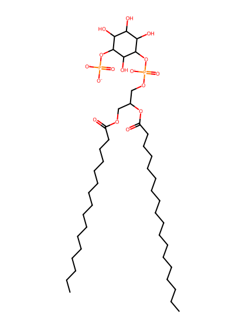
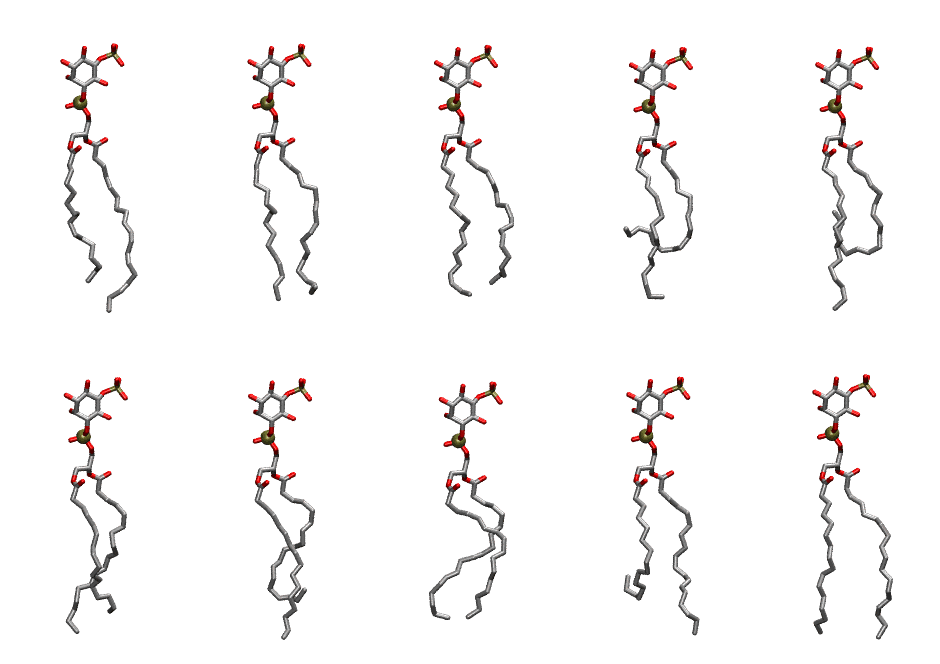

.. _lipid_gallery pnpi15:

PNPI15
======

**1-Palmitoyl-2-Linolenoyl-inositol-(5)-phosphate (PIP1)**

==============  ===================================
CHARMM resname  ``PNPI15``
Net charge      -3.00
Atoms           136
Topology file   ``toppar_all36_lipid_inositol.str``
Conformers      10 fluid
==============  ===================================

Structure
---------

Conformers
----------

The grid packer draws a conformer per lipid from this ensemble, so what the ensemble contains is what a built bilayer is made of. A leaflet declared ``phase: Lo`` generates an ordered ensemble when a build first needs it. All conformers are rendered at one shared scale.

=============  =============  ================  ================
Conformer      Head-tail (Å)  Max internal (Å)  Min chain extent
=============  =============  ================  ================
``PNPI15-00``  14.99          31.13             0.76
``PNPI15-01``  15.68          29.96             0.74
``PNPI15-02``  15.03          29.12             0.71
``PNPI15-03``  8.77           29.43             0.42
``PNPI15-04``  6.92           30.70             0.33
``PNPI15-05``  14.63          30.47             0.74
``PNPI15-06``  12.13          30.52             0.58
``PNPI15-07``  14.78          28.16             0.70
``PNPI15-08``  10.84          30.21             0.54
``PNPI15-09``  17.32          31.52             0.84
=============  =============  ================  ================

*Min chain extent* is how far the least-extended acyl chain descends below its own attachment carbon, as a fraction of that chain's all-trans contour; an all-trans chain scores 1.0, and a conformer under 0.25 is rejected at generation as folded.

Provenance
----------

How the ensemble was generated, read from the entry's own ``info.yaml``:

===================  ============
Setting              ``PNPI15``
===================  ============
Sampler              ``mc``
Phase                none (fluid)
Trans bias           0.0
Chain order          0.220
MC seed              0
Chains               2
Cylinder APL         60.0 Ų
Cylinder inflation   1.9
Equilibration steps  20000
Decorrelation steps  3000
Max MC angle         30°
Radius scale         0.8
Axial bias           1.0
===================  ============
