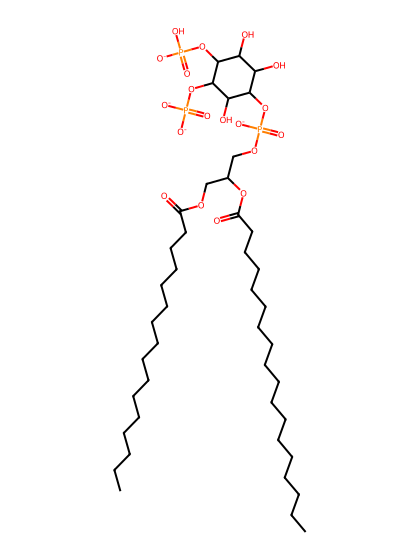
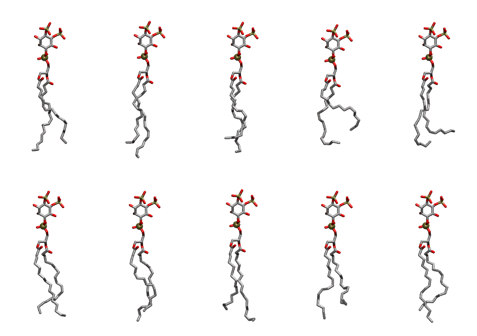

.. _lipid_gallery pnpi24:

PNPI24
======

**1-Palmitoyl-2-Linolenoyl-inositol-(4,5)-bisphosphate (PIP2) with protonation on P4**

==============  ===================================
CHARMM resname  ``PNPI24``
Net charge      -4.00
Atoms           140
Topology file   ``toppar_all36_lipid_inositol.str``
Conformers      10 fluid
==============  ===================================

Structure
---------

Conformers
----------

The grid packer draws a conformer per lipid from this ensemble, so what the ensemble contains is what a built bilayer is made of. A leaflet declared ``phase: Lo`` generates an ordered ensemble when a build first needs it. All conformers are rendered at one shared scale.

=============  =============  ================  ================
Conformer      Head-tail (Å)  Max internal (Å)  Min chain extent
=============  =============  ================  ================
``PNPI24-00``  13.78          30.89             0.74
``PNPI24-01``  13.97          33.23             0.77
``PNPI24-02``  12.77          31.90             0.71
``PNPI24-03``  10.20          29.04             0.57
``PNPI24-04``  11.09          30.54             0.62
``PNPI24-05``  14.16          30.02             0.68
``PNPI24-06``  13.62          32.05             0.75
``PNPI24-07``  13.59          32.26             0.75
``PNPI24-08``  11.01          30.38             0.53
``PNPI24-09``  13.50          31.45             0.65
=============  =============  ================  ================

*Min chain extent* is how far the least-extended acyl chain descends below its own attachment carbon, as a fraction of that chain's all-trans contour; an all-trans chain scores 1.0, and a conformer under 0.25 is rejected at generation as folded.

Provenance
----------

How the ensemble was generated, read from the entry's own ``info.yaml``:

===================  ============
Setting              ``PNPI24``
===================  ============
Sampler              ``mc``
Phase                none (fluid)
Trans bias           0.0
Chain order          0.175
MC seed              0
Chains               2
Cylinder APL         60.0 Ų
Cylinder inflation   1.9
Equilibration steps  20000
Decorrelation steps  3000
Max MC angle         30°
Radius scale         0.8
Axial bias           1.0
===================  ============
