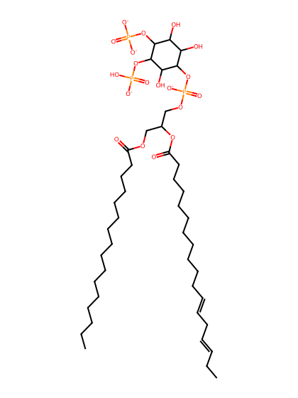
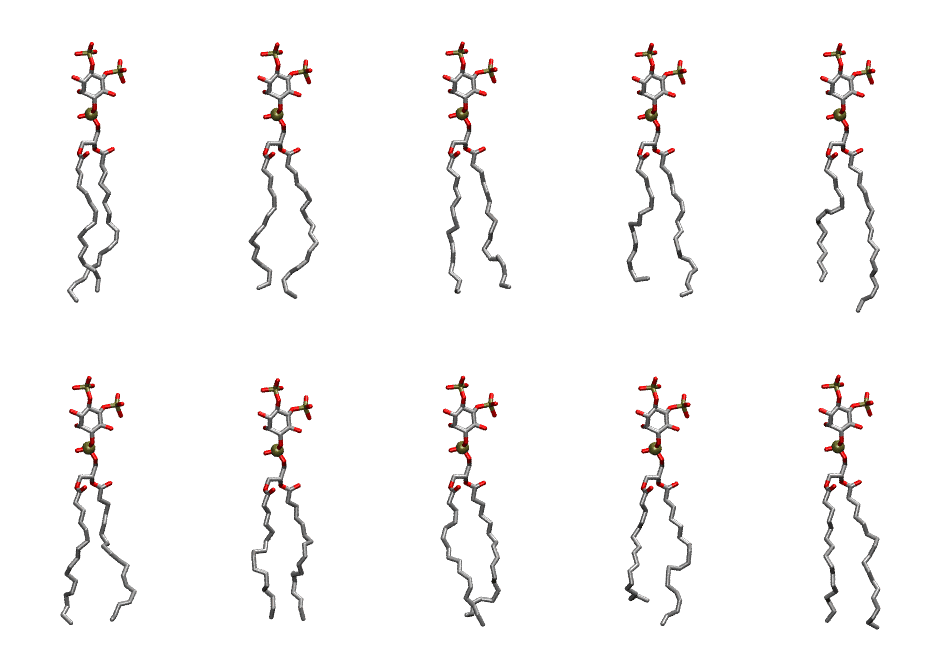

.. _lipid_gallery pnpi25:

PNPI25
======

**1-Palmitoyl-2-Linolenoyl-inositol-(4,5)-bisphosphate (PIP2) with protonation on P5**

==============  ===================================
CHARMM resname  ``PNPI25``
Net charge      -4.00
Atoms           140
Topology file   ``toppar_all36_lipid_inositol.str``
Conformers      10 fluid
==============  ===================================

Structure
---------

Conformers
----------

The grid packer draws a conformer per lipid from this ensemble, so what the ensemble contains is what a built bilayer is made of. A leaflet declared ``phase: Lo`` generates an ordered ensemble when a build first needs it. All conformers are rendered at one shared scale.

=============  =============  ================  ================
Conformer      Head-tail (Å)  Max internal (Å)  Min chain extent
=============  =============  ================  ================
``PNPI25-00``  17.09          33.09             0.85
``PNPI25-01``  16.74          32.90             0.82
``PNPI25-02``  16.73          31.97             0.77
``PNPI25-03``  15.48          32.22             0.78
``PNPI25-04``  15.72          34.40             0.80
``PNPI25-05``  16.49          31.53             0.76
``PNPI25-06``  15.91          31.11             0.75
``PNPI25-07``  15.96          31.66             0.74
``PNPI25-08``  14.03          31.51             0.71
``PNPI25-09``  16.77          32.69             0.82
=============  =============  ================  ================

*Min chain extent* is how far the least-extended acyl chain descends below its own attachment carbon, as a fraction of that chain's all-trans contour; an all-trans chain scores 1.0, and a conformer under 0.25 is rejected at generation as folded.

Provenance
----------

How the ensemble was generated, read from the entry's own ``info.yaml``:

===================  ============
Setting              ``PNPI25``
===================  ============
Sampler              ``mc``
Phase                none (fluid)
Trans bias           0.0
Chain order          0.236
MC seed              0
Chains               2
Cylinder APL         60.0 Ų
Cylinder inflation   1.9
Equilibration steps  20000
Decorrelation steps  3000
Max MC angle         30°
Radius scale         0.8
Axial bias           1.0
===================  ============
