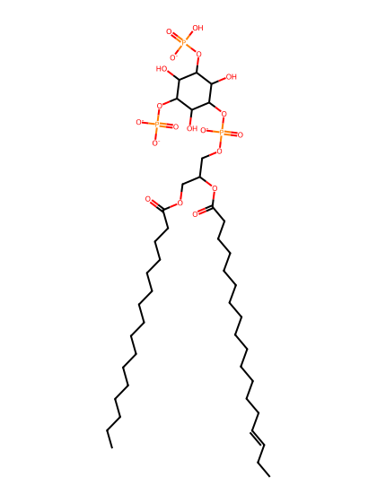
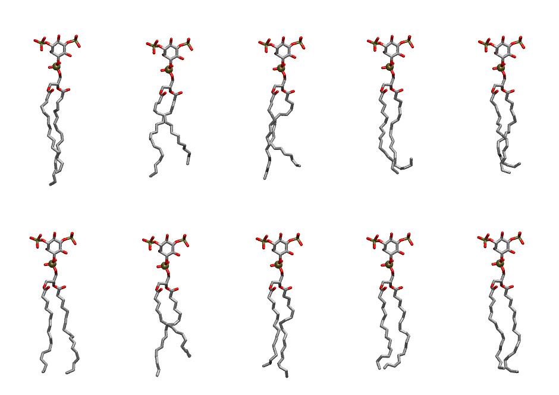

.. _lipid_gallery pnpi2a:

PNPI2A
======

**1-Palmitoyl-2-Linolenoyl-inositol-(3,5)-bisphosphate (PIP2) with protonation on P3**

==============  ===================================
CHARMM resname  ``PNPI2A``
Net charge      -4.00
Atoms           140
Topology file   ``toppar_all36_lipid_inositol.str``
Conformers      10 fluid
==============  ===================================

Structure
---------

Conformers
----------

The grid packer draws a conformer per lipid from this ensemble, so what the ensemble contains is what a built bilayer is made of. A leaflet declared ``phase: Lo`` generates an ordered ensemble when a build first needs it. All conformers are rendered at one shared scale.

=============  =============  ================  ================
Conformer      Head-tail (Å)  Max internal (Å)  Min chain extent
=============  =============  ================  ================
``PNPI2A-00``  17.00          33.19             0.86
``PNPI2A-01``  14.60          30.55             0.74
``PNPI2A-02``  15.28          30.53             0.69
``PNPI2A-03``  14.13          29.99             0.64
``PNPI2A-04``  14.92          29.87             0.68
``PNPI2A-05``  17.42          30.84             0.80
``PNPI2A-06``  13.65          30.64             0.69
``PNPI2A-07``  16.06          31.55             0.81
``PNPI2A-08``  16.51          29.71             0.75
``PNPI2A-09``  16.81          31.64             0.79
=============  =============  ================  ================

*Min chain extent* is how far the least-extended acyl chain descends below its own attachment carbon, as a fraction of that chain's all-trans contour; an all-trans chain scores 1.0, and a conformer under 0.25 is rejected at generation as folded.

Provenance
----------

How the ensemble was generated, read from the entry's own ``info.yaml``:

===================  ============
Setting              ``PNPI2A``
===================  ============
Sampler              ``mc``
Phase                none (fluid)
Trans bias           0.0
Chain order          0.237
MC seed              0
Chains               2
Cylinder APL         60.0 Ų
Cylinder inflation   1.9
Equilibration steps  20000
Decorrelation steps  3000
Max MC angle         30°
Radius scale         0.8
Axial bias           1.0
===================  ============
