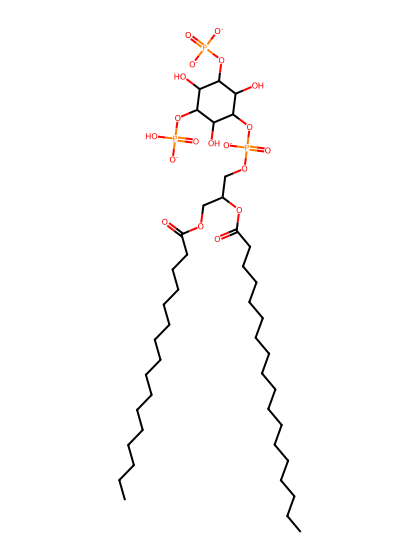
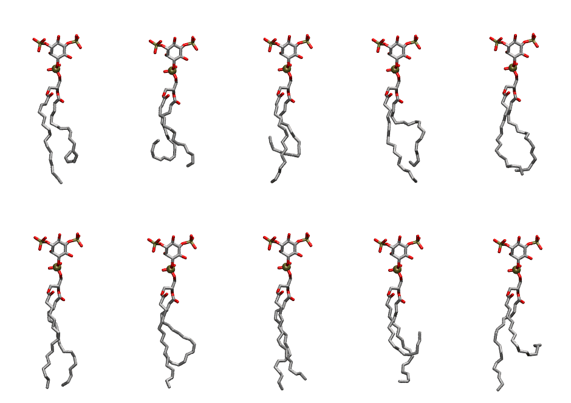

.. _lipid_gallery pnpi2b:

PNPI2B
======

**1-Palmitoyl-2-Linolenoyl-inositol-(3,5)-bisphosphate (PIP2) with protonation on P5**

==============  ===================================
CHARMM resname  ``PNPI2B``
Net charge      -4.00
Atoms           140
Topology file   ``toppar_all36_lipid_inositol.str``
Conformers      10 fluid
==============  ===================================

Structure
---------

Conformers
----------

The grid packer draws a conformer per lipid from this ensemble, so what the ensemble contains is what a built bilayer is made of. A leaflet declared ``phase: Lo`` generates an ordered ensemble when a build first needs it. All conformers are rendered at one shared scale.

=============  =============  ================  ================
Conformer      Head-tail (Å)  Max internal (Å)  Min chain extent
=============  =============  ================  ================
``PNPI2B-00``  9.70           29.79             0.47
``PNPI2B-01``  7.18           26.76             0.35
``PNPI2B-02``  6.91           30.14             0.34
``PNPI2B-03``  11.59          29.93             0.56
``PNPI2B-04``  13.53          28.46             0.65
``PNPI2B-05``  16.50          31.09             0.79
``PNPI2B-06``  9.83           30.63             0.48
``PNPI2B-07``  15.35          31.56             0.82
``PNPI2B-08``  5.91           29.75             0.36
``PNPI2B-09``  8.25           31.38             0.48
=============  =============  ================  ================

*Min chain extent* is how far the least-extended acyl chain descends below its own attachment carbon, as a fraction of that chain's all-trans contour; an all-trans chain scores 1.0, and a conformer under 0.25 is rejected at generation as folded.

Provenance
----------

How the ensemble was generated, read from the entry's own ``info.yaml``:

===================  ============
Setting              ``PNPI2B``
===================  ============
Sampler              ``mc``
Phase                none (fluid)
Trans bias           0.0
Chain order          0.213
MC seed              0
Chains               2
Cylinder APL         60.0 Ų
Cylinder inflation   1.9
Equilibration steps  20000
Decorrelation steps  3000
Max MC angle         30°
Radius scale         0.8
Axial bias           1.0
===================  ============
