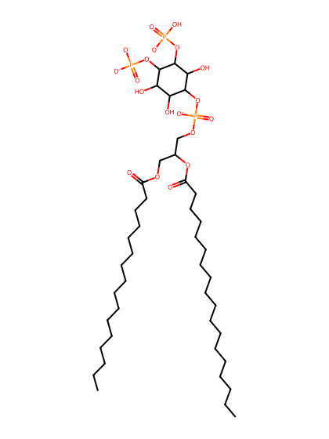
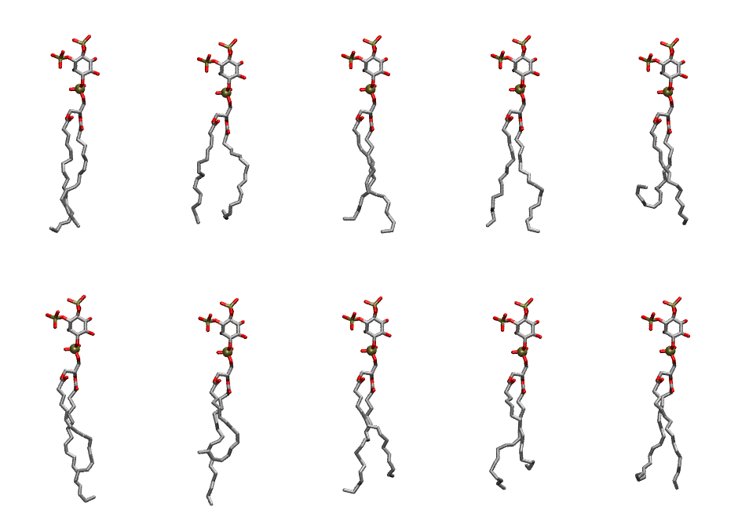

.. _lipid_gallery pnpi2c:

PNPI2C
======

**1-Palmitoyl-2-Linolenoyl-inositol-(3,4)-trisphosphate (PIP2) with protonation on P3**

==============  ===================================
CHARMM resname  ``PNPI2C``
Net charge      -4.00
Atoms           140
Topology file   ``toppar_all36_lipid_inositol.str``
Conformers      10 fluid
==============  ===================================

Structure
---------

Conformers
----------

The grid packer draws a conformer per lipid from this ensemble, so what the ensemble contains is what a built bilayer is made of. A leaflet declared ``phase: Lo`` generates an ordered ensemble when a build first needs it. All conformers are rendered at one shared scale.

=============  =============  ================  ================
Conformer      Head-tail (Å)  Max internal (Å)  Min chain extent
=============  =============  ================  ================
``PNPI2C-00``  15.65          32.92             0.76
``PNPI2C-01``  12.63          30.83             0.61
``PNPI2C-02``  14.41          32.31             0.79
``PNPI2C-03``  15.48          32.34             0.78
``PNPI2C-04``  8.92           30.35             0.44
``PNPI2C-05``  14.65          33.91             0.83
``PNPI2C-06``  9.71           34.30             0.58
``PNPI2C-07``  13.73          32.67             0.76
``PNPI2C-08``  11.90          31.79             0.69
``PNPI2C-09``  13.81          31.44             0.66
=============  =============  ================  ================

*Min chain extent* is how far the least-extended acyl chain descends below its own attachment carbon, as a fraction of that chain's all-trans contour; an all-trans chain scores 1.0, and a conformer under 0.25 is rejected at generation as folded.

Provenance
----------

How the ensemble was generated, read from the entry's own ``info.yaml``:

===================  ============
Setting              ``PNPI2C``
===================  ============
Sampler              ``mc``
Phase                none (fluid)
Trans bias           0.0
Chain order          0.233
MC seed              0
Chains               2
Cylinder APL         60.0 Ų
Cylinder inflation   1.9
Equilibration steps  20000
Decorrelation steps  3000
Max MC angle         30°
Radius scale         0.8
Axial bias           1.0
===================  ============
