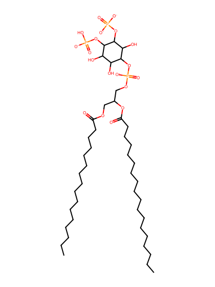
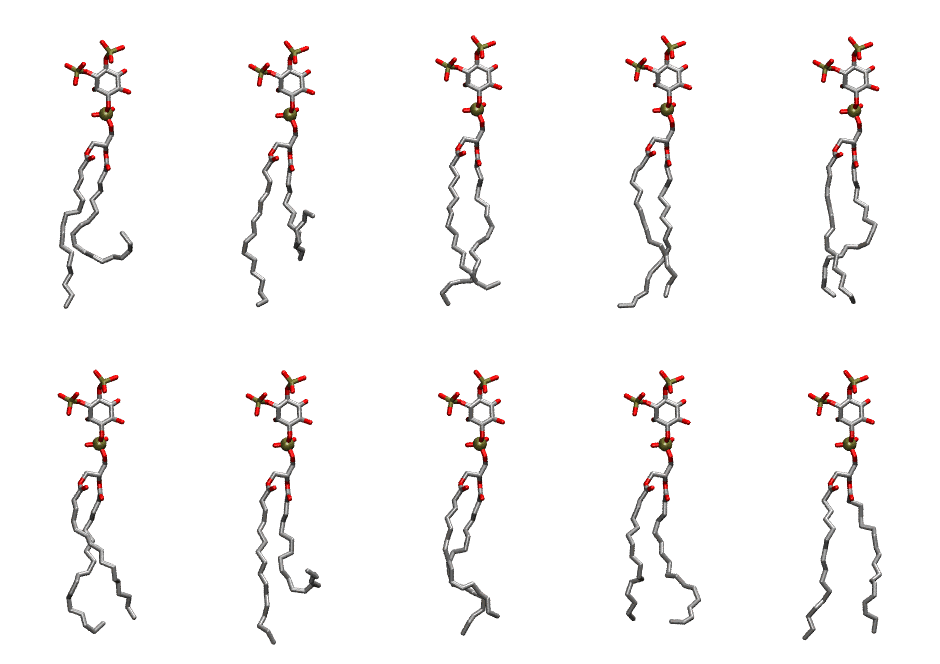

.. _lipid_gallery pnpi2d:

PNPI2D
======

**1-Palmitoyl-2-Linolenoyl-inositol-(3,4)-bisphosphate (PIP2) with protonation on P4**

==============  ===================================
CHARMM resname  ``PNPI2D``
Net charge      -4.00
Atoms           140
Topology file   ``toppar_all36_lipid_inositol.str``
Conformers      10 fluid
==============  ===================================

Structure
---------

Conformers
----------

The grid packer draws a conformer per lipid from this ensemble, so what the ensemble contains is what a built bilayer is made of. A leaflet declared ``phase: Lo`` generates an ordered ensemble when a build first needs it. All conformers are rendered at one shared scale.

=============  =============  ================  ================
Conformer      Head-tail (Å)  Max internal (Å)  Min chain extent
=============  =============  ================  ================
``PNPI2D-00``  7.60           32.60             0.38
``PNPI2D-01``  5.48           32.15             0.28
``PNPI2D-02``  13.97          32.88             0.78
``PNPI2D-03``  15.45          33.19             0.79
``PNPI2D-04``  15.29          31.85             0.73
``PNPI2D-05``  14.00          31.73             0.70
``PNPI2D-06``  8.45           32.97             0.41
``PNPI2D-07``  13.82          31.85             0.76
``PNPI2D-08``  14.07          30.65             0.69
``PNPI2D-09``  15.60          33.05             0.75
=============  =============  ================  ================

*Min chain extent* is how far the least-extended acyl chain descends below its own attachment carbon, as a fraction of that chain's all-trans contour; an all-trans chain scores 1.0, and a conformer under 0.25 is rejected at generation as folded.

Provenance
----------

How the ensemble was generated, read from the entry's own ``info.yaml``:

===================  ============
Setting              ``PNPI2D``
===================  ============
Sampler              ``mc``
Phase                none (fluid)
Trans bias           0.0
Chain order          0.242
MC seed              0
Chains               2
Cylinder APL         60.0 Ų
Cylinder inflation   1.9
Equilibration steps  20000
Decorrelation steps  3000
Max MC angle         30°
Radius scale         0.8
Axial bias           1.0
===================  ============
