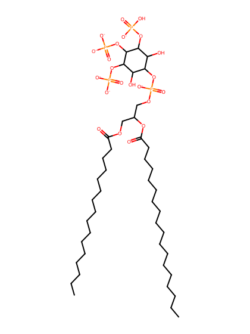
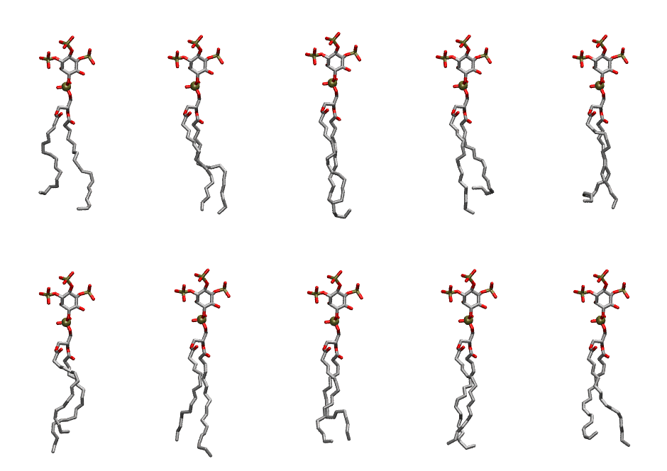

.. _lipid_gallery pnpi33:

PNPI33
======

**1-Palmitoyl-2-Linolenoyl-inositol-(3,4,5)-trisphosphate (PIP3) with protonation on P3**

==============  ===================================
CHARMM resname  ``PNPI33``
Net charge      -6.00
Atoms           143
Topology file   ``toppar_all36_lipid_inositol.str``
Conformers      10 fluid
==============  ===================================

Structure
---------

Conformers
----------

The grid packer draws a conformer per lipid from this ensemble, so what the ensemble contains is what a built bilayer is made of. A leaflet declared ``phase: Lo`` generates an ordered ensemble when a build first needs it. All conformers are rendered at one shared scale.

=============  =============  ================  ================
Conformer      Head-tail (Å)  Max internal (Å)  Min chain extent
=============  =============  ================  ================
``PNPI33-00``  12.04          30.88             0.69
``PNPI33-01``  15.09          31.88             0.75
``PNPI33-02``  14.43          33.30             0.75
``PNPI33-03``  11.45          31.55             0.55
``PNPI33-04``  13.69          30.53             0.66
``PNPI33-05``  12.61          32.33             0.72
``PNPI33-06``  14.54          33.13             0.82
``PNPI33-07``  14.11          30.53             0.67
``PNPI33-08``  15.05          31.95             0.74
``PNPI33-09``  13.16          31.63             0.63
=============  =============  ================  ================

*Min chain extent* is how far the least-extended acyl chain descends below its own attachment carbon, as a fraction of that chain's all-trans contour; an all-trans chain scores 1.0, and a conformer under 0.25 is rejected at generation as folded.

Provenance
----------

How the ensemble was generated, read from the entry's own ``info.yaml``:

===================  ============
Setting              ``PNPI33``
===================  ============
Sampler              ``mc``
Phase                none (fluid)
Trans bias           0.0
Chain order          0.211
MC seed              0
Chains               2
Cylinder APL         60.0 Ų
Cylinder inflation   1.9
Equilibration steps  20000
Decorrelation steps  3000
Max MC angle         30°
Radius scale         0.8
Axial bias           1.0
===================  ============
