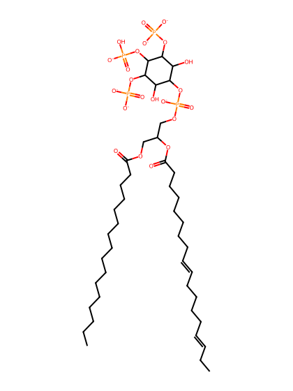
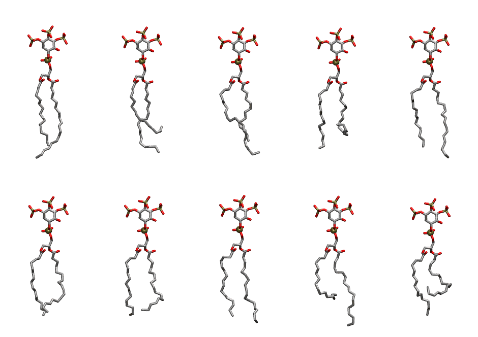

.. _lipid_gallery pnpi34:

PNPI34
======

**1-Palmitoyl-2-Linolenoyl-inositol-(3,4,5)-trisphosphate (PIP3) with protonation on P4**

==============  ===================================
CHARMM resname  ``PNPI34``
Net charge      -6.00
Atoms           143
Topology file   ``toppar_all36_lipid_inositol.str``
Conformers      10 fluid
==============  ===================================

Structure
---------

Conformers
----------

The grid packer draws a conformer per lipid from this ensemble, so what the ensemble contains is what a built bilayer is made of. A leaflet declared ``phase: Lo`` generates an ordered ensemble when a build first needs it. All conformers are rendered at one shared scale.

=============  =============  ================  ================
Conformer      Head-tail (Å)  Max internal (Å)  Min chain extent
=============  =============  ================  ================
``PNPI34-00``  15.55          32.73             0.80
``PNPI34-01``  10.88          31.23             0.55
``PNPI34-02``  14.05          31.67             0.72
``PNPI34-03``  10.11          30.27             0.45
``PNPI34-04``  15.50          32.23             0.79
``PNPI34-05``  14.56          29.52             0.66
``PNPI34-06``  14.19          30.41             0.64
``PNPI34-07``  15.77          31.69             0.79
``PNPI34-08``  10.57          32.35             0.54
``PNPI34-09``  8.18           29.14             0.36
=============  =============  ================  ================

*Min chain extent* is how far the least-extended acyl chain descends below its own attachment carbon, as a fraction of that chain's all-trans contour; an all-trans chain scores 1.0, and a conformer under 0.25 is rejected at generation as folded.

Provenance
----------

How the ensemble was generated, read from the entry's own ``info.yaml``:

===================  ============
Setting              ``PNPI34``
===================  ============
Sampler              ``mc``
Phase                none (fluid)
Trans bias           0.0
Chain order          0.189
MC seed              0
Chains               2
Cylinder APL         60.0 Ų
Cylinder inflation   1.9
Equilibration steps  20000
Decorrelation steps  3000
Max MC angle         30°
Radius scale         0.8
Axial bias           1.0
===================  ============
