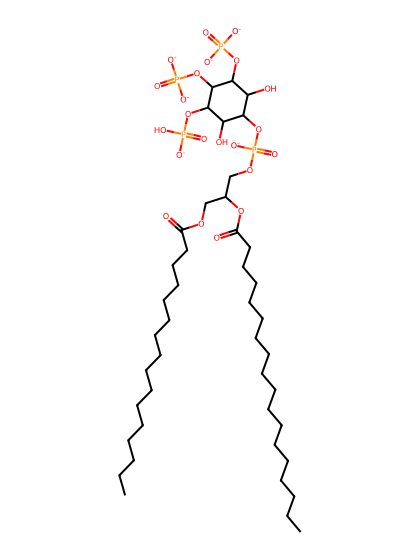
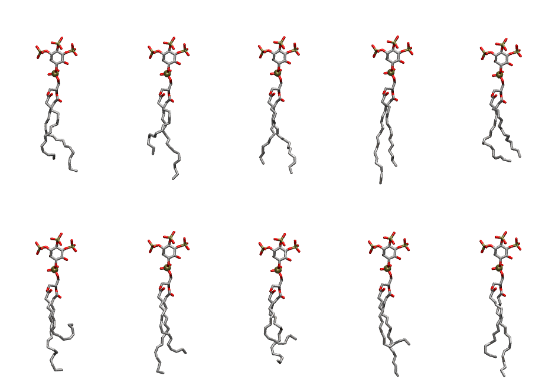

.. _lipid_gallery pnpi35:

PNPI35
======

**1-Palmitoyl-2-Linolenoyl-inositol-(3,4,5)-trisphosphate (PIP3) with protonation on P5**

==============  ===================================
CHARMM resname  ``PNPI35``
Net charge      -6.00
Atoms           143
Topology file   ``toppar_all36_lipid_inositol.str``
Conformers      10 fluid
==============  ===================================

Structure
---------

Conformers
----------

The grid packer draws a conformer per lipid from this ensemble, so what the ensemble contains is what a built bilayer is made of. A leaflet declared ``phase: Lo`` generates an ordered ensemble when a build first needs it. All conformers are rendered at one shared scale.

=============  =============  ================  ================
Conformer      Head-tail (Å)  Max internal (Å)  Min chain extent
=============  =============  ================  ================
``PNPI35-00``  13.11          32.03             0.74
``PNPI35-01``  12.03          33.38             0.68
``PNPI35-02``  14.29          31.62             0.79
``PNPI35-03``  14.95          34.62             0.84
``PNPI35-04``  12.35          28.57             0.64
``PNPI35-05``  6.25           32.50             0.38
``PNPI35-06``  13.13          33.16             0.74
``PNPI35-07``  9.44           30.22             0.55
``PNPI35-08``  10.97          34.02             0.63
``PNPI35-09``  13.98          33.92             0.79
=============  =============  ================  ================

*Min chain extent* is how far the least-extended acyl chain descends below its own attachment carbon, as a fraction of that chain's all-trans contour; an all-trans chain scores 1.0, and a conformer under 0.25 is rejected at generation as folded.

Provenance
----------

How the ensemble was generated, read from the entry's own ``info.yaml``:

===================  ============
Setting              ``PNPI35``
===================  ============
Sampler              ``mc``
Phase                none (fluid)
Trans bias           0.0
Chain order          0.209
MC seed              0
Chains               2
Cylinder APL         60.0 Ų
Cylinder inflation   1.9
Equilibration steps  20000
Decorrelation steps  3000
Max MC angle         30°
Radius scale         0.8
Axial bias           1.0
===================  ============
