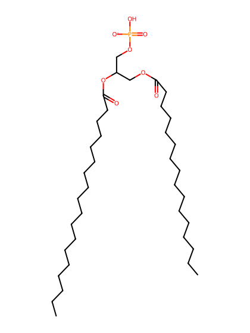
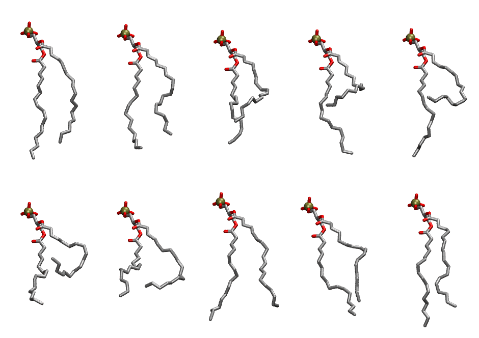

.. _lipid_gallery popa:

POPA
====

**3-palmitoyl-2-oleoyl-D-glycero-1-Phosphatidic acid**

==============  =======================
CHARMM resname  ``POPA``
Net charge      -1.00
Atoms           116
Topology file   ``top_all36_lipid.rtf``
Conformers      10 fluid
==============  =======================

Structure
---------

Conformers
----------

The grid packer draws a conformer per lipid from this ensemble, so what the ensemble contains is what a built bilayer is made of. A leaflet declared ``phase: Lo`` generates an ordered ensemble when a build first needs it. All conformers are rendered at one shared scale.

===========  =============  ================  ================
Conformer    Head-tail (Å)  Max internal (Å)  Min chain extent
===========  =============  ================  ================
``POPA-00``  14.13          25.05             0.77
``POPA-01``  12.30          24.51             0.69
``POPA-02``  9.02           23.24             0.54
``POPA-03``  6.33           24.27             0.41
``POPA-04``  5.19           23.18             0.36
``POPA-05``  3.02           23.49             0.26
``POPA-06``  7.93           22.75             0.49
``POPA-07``  12.92          25.24             0.72
``POPA-08``  11.25          24.53             0.64
``POPA-09``  12.76          25.04             0.71
===========  =============  ================  ================

*Min chain extent* is how far the least-extended acyl chain descends below its own attachment carbon, as a fraction of that chain's all-trans contour; an all-trans chain scores 1.0, and a conformer under 0.25 is rejected at generation as folded.

Provenance
----------

How the ensemble was generated, read from the entry's own ``info.yaml``:

===================  ============
Setting              ``POPA``
===================  ============
Sampler              ``mc``
Phase                none (fluid)
Trans bias           0.0
Chain order          0.086
MC seed              0
Chains               2
Cylinder APL         60.0 Ų
Cylinder inflation   1.9
Equilibration steps  20000
Decorrelation steps  3000
Max MC angle         30°
Radius scale         0.8
Axial bias           1.0
===================  ============
