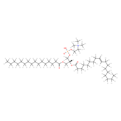
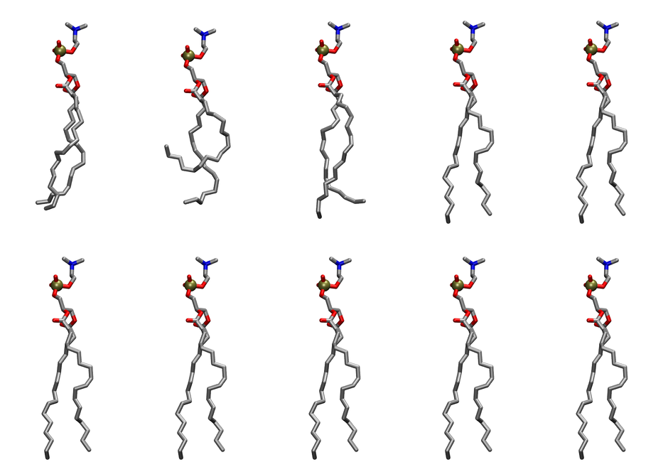

.. _lipid_gallery popc:

POPC
====

.. note::

   **Prototype page.** One lipid, built by hand, to decide whether a full gallery of all 277
   shipped entries is worth generating. See :ref:`lipid_gallery index` for what a full build
   would cost and what is still unsettled.

**3-palmitoyl-2-oleoyl-D-glycero-1-Phosphatidylcholine** — a 16:0/18:1 phosphatidylcholine, and
one of the most-used entries in the shipped collection.

=====================  ==========================================
CHARMM resname         ``POPC``
Net charge             0.00
Atoms                  134
Topology file          ``top_all36_lipid.rtf``
Stream                 ``lipid``
Conformers             10
=====================  ==========================================

Structure
---------

Drawn the way lipids conventionally are: headgroup at the top, both tails hanging down, no
explicit hydrogens. That orientation is derived from the molecule rather than set by hand, so it
holds for every non-sterol lipid — see :ref:`lipid_gallery index`.

Conformers
----------

The grid packer draws a conformer per lipid from this ensemble, so what the ensemble contains is
what a built bilayer is made of. All ten are rendered **at one shared scale**, so differences in
extension are real rather than an artifact of per-image framing.

Read left to right, top row then bottom. The spread is what the ensemble is for: the packer draws
one shape per lipid, so a bilayer is built out of this variety rather than out of one repeated
conformer.

================  ===============  ==================  ==================
Conformer         Head-tail (Å)    Max internal (Å)    Min chain extent
================  ===============  ==================  ==================
``POPC-00``       16.11            29.42               0.83
``POPC-01``       14.10            30.63               0.72
``POPC-02``       16.99            28.86               0.83
``POPC-03``       14.99            28.23               0.75
``POPC-04``       6.86             25.95               0.34
``POPC-05``       15.60            30.33               0.80
``POPC-06``       14.86            28.53               0.76
``POPC-07``       15.42            28.05               0.74
``POPC-08``       12.04            26.77               0.62
``POPC-09``       16.66            28.94               0.79
================  ===============  ==================  ==================

All ten are distinct, verified by hashing coordinates rather than by comparing the metrics above.

*Min chain extent* is how far the least-extended acyl chain descends below its own attachment
carbon, as a fraction of that chain's all-trans contour. An all-trans chain scores 1.0; anything
under 0.25 is rejected at generation as folded. Every conformer here passes, ``POPC-04`` least
comfortably — its sn-2 chain descends 7.4 Å of a 21.6 Å contour.

.. note::

   **This page caught a sampler defect, and now shows the repaired ensemble.**

   Its first version — drawn from the collection shipped in 3.26.0 — showed POPC with **four
   distinct conformers of ten**, one draw repeated seven times. The cause was in ``run_mc``: its
   sample-collection test sat inside the accepted-move branch, so a checkpoint fired only when
   the proposal that happened to land on it was accepted. Most checkpoints never fired, and the
   shortfall was padded with copies of the final conformer. Across the whole shipped collection
   only **1416 of 2690 conformers (53%) were distinct**, no entry reached ten, and one entry was
   a single conformer repeated ten times.

   Sampling now runs on the step schedule: a rejected move leaves the chain in a state that is
   still worth recording. Regenerating POPC with the same seed and settings gives ten distinct
   conformers, and the four that shipped are all still among them — the fix restores draws that
   padding was swallowing rather than moving the sampler somewhere new.

   The defect was visible in the metadata for anyone who looked, and nobody had. It was obvious
   on sight in a contact sheet. That is the argument for building the rest of this gallery.

Provenance
----------

How this ensemble was generated, read from the entry's own ``info.yaml``:

====================  =============
Sampler               ``mc``
Phase                 none (fluid)
Trans bias            0.0
Chain order           0.212
MC seed               0
Chains                2
Cylinder APL          60.0 Ų
Cylinder inflation    1.9
Equilibration steps   20000
Decorrelation steps   3000
Max MC angle          30°
Radius scale          0.8
Axial bias            1.0
====================  =============

Every value above is read from the shipped entry, not chosen for the page: the collection records
its own generation settings so an entry can be reproduced or audited later.
