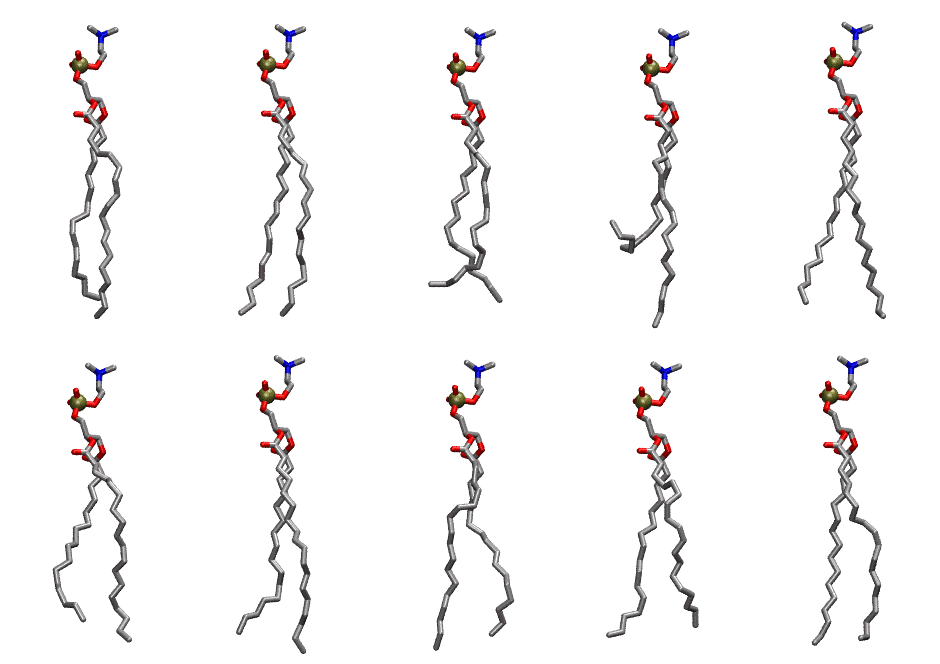

.. _lipid_gallery popc:

POPC
====

**3-palmitoyl-2-oleoyl-D-glycero-1-Phosphatidylcholine**

==============  ==========================================
CHARMM resname  ``POPC``
Net charge      0.00
Atoms           134
Topology file   ``top_all36_lipid.rtf``
Conformers      10 fluid, 10 liquid-ordered (``POPC__Lo``)
==============  ==========================================

Structure
---------

.. image:: img/popc-structure.svg
   :width: 340px
   :alt: Two-dimensional structure of POPC

Conformers
----------

The grid packer draws a conformer per lipid from an ensemble, so what the ensemble contains is what a built bilayer is made of. POPC ships two: a fluid one, used by default, and a liquid-ordered one, used for a leaflet declared ``phase: Lo``. All conformers on this page are rendered at one shared scale.

Fluid (``POPC``)
~~~~~~~~~~~~~~~~

.. image:: img/popc-conformers.png
   :width: 100%
   :alt: 10 POPC conformer(s) at a shared scale

===========  =============  ================  ================
Conformer    Head-tail (Å)  Max internal (Å)  Min chain extent
===========  =============  ================  ================
``POPC-00``  16.11          29.42             0.83
``POPC-01``  14.10          30.63             0.72
``POPC-02``  16.99          28.86             0.83
``POPC-03``  14.99          28.23             0.75
``POPC-04``  6.86           25.95             0.34
``POPC-05``  15.60          30.33             0.80
``POPC-06``  14.86          28.53             0.76
``POPC-07``  15.42          28.05             0.74
``POPC-08``  12.04          26.77             0.62
``POPC-09``  16.66          28.94             0.79
===========  =============  ================  ================

Liquid-ordered (``POPC__Lo``)
~~~~~~~~~~~~~~~~~~~~~~~~~~~~~

===========  =============  ================  ================
Conformer    Head-tail (Å)  Max internal (Å)  Min chain extent
===========  =============  ================  ================
``POPC-00``  16.87          30.18             0.87
``POPC-01``  18.33          30.50             0.88
``POPC-02``  15.34          27.57             0.73
``POPC-03``  9.42           30.67             0.48
``POPC-04``  17.54          30.27             0.90
``POPC-05``  15.32          29.47             0.79
``POPC-06``  17.21          30.63             0.89
``POPC-07``  16.97          30.41             0.87
``POPC-08``  15.97          29.08             0.76
``POPC-09``  17.75          29.53             0.84
===========  =============  ================  ================

*Min chain extent* is how far the least-extended acyl chain descends below its own attachment carbon, as a fraction of that chain's all-trans contour; an all-trans chain scores 1.0, and a conformer under 0.25 is rejected at generation as folded.

Provenance
----------

How each ensemble was generated, read from the entry's own ``info.yaml``:

===================  ============  ============
Setting              ``POPC``      ``POPC__Lo``
===================  ============  ============
Sampler              ``mc``        ``mc``
Phase                none (fluid)  Lo
Trans bias           0.0           2.5
Chain order          0.212         0.286
MC seed              0             1
Chains               2             2
Cylinder APL         60.0 Ų       60.0 Ų
Cylinder inflation   1.9           1.9
Equilibration steps  20000         20000
Decorrelation steps  3000          3000
Max MC angle         30°           30°
Radius scale         0.8           0.8
Axial bias           1.0           1.0
===================  ============  ============
