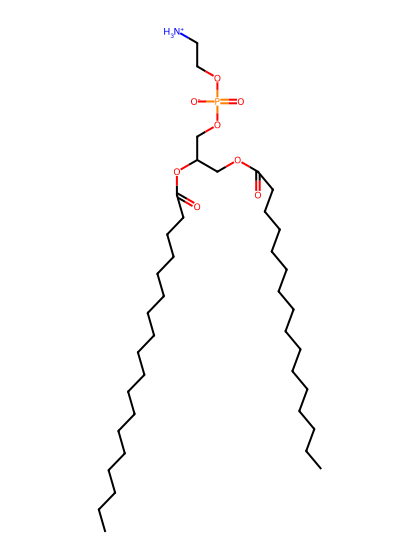
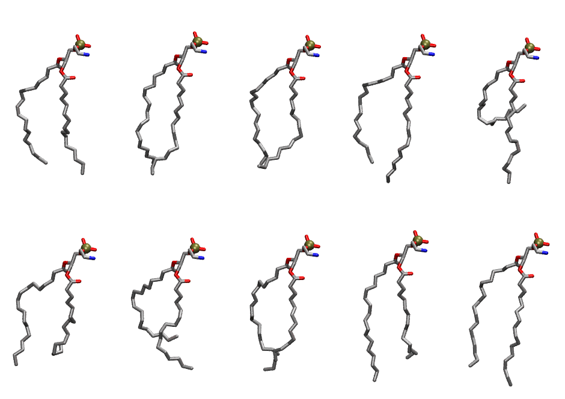
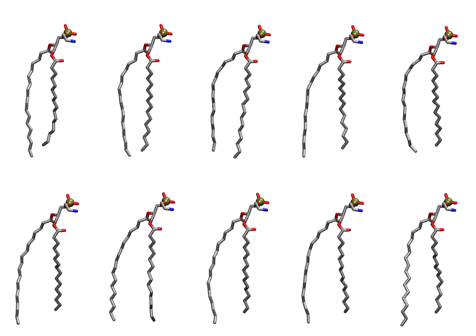

.. _lipid_gallery pope:

POPE
====

**3-palmitoyl-2-oleoyl-D-glycero-1-Phosphatidylethanolamine**

==============  ==========================================
CHARMM resname  ``POPE``
Net charge      0.00
Atoms           125
Topology file   ``top_all36_lipid.rtf``
Conformers      10 fluid, 10 liquid-ordered (``POPE__Lo``)
==============  ==========================================

Structure
---------

Conformers
----------

The grid packer draws a conformer per lipid from an ensemble, so what the ensemble contains is what a built bilayer is made of. POPE ships two: a fluid one, used by default, and a liquid-ordered one, used for a leaflet declared ``phase: Lo``. All conformers on this page are rendered at one shared scale.

Fluid (``POPE``)
~~~~~~~~~~~~~~~~

===========  =============  ================  ================
Conformer    Head-tail (Å)  Max internal (Å)  Min chain extent
===========  =============  ================  ================
``POPE-00``  13.52          24.53             0.72
``POPE-01``  14.00          25.28             0.74
``POPE-02``  13.55          25.83             0.72
``POPE-03``  13.45          25.83             0.71
``POPE-04``  3.88           24.98             0.27
``POPE-05``  9.95           24.84             0.52
``POPE-06``  8.78           21.99             0.50
``POPE-07``  12.07          24.82             0.65
``POPE-08``  13.34          26.32             0.70
``POPE-09``  14.26          25.12             0.75
===========  =============  ================  ================

Liquid-ordered (``POPE__Lo``)
~~~~~~~~~~~~~~~~~~~~~~~~~~~~~

===========  =============  ================  ================
Conformer    Head-tail (Å)  Max internal (Å)  Min chain extent
===========  =============  ================  ================
``POPE-00``  15.87          26.62             0.83
``POPE-01``  16.93          26.76             0.89
``POPE-02``  16.77          27.64             0.87
``POPE-03``  16.28          27.56             0.85
``POPE-04``  15.57          26.90             0.81
``POPE-05``  14.93          27.32             0.78
``POPE-06``  17.14          28.29             0.88
``POPE-07``  15.57          26.74             0.82
``POPE-08``  15.44          27.31             0.81
``POPE-09``  15.56          26.85             0.81
===========  =============  ================  ================

*Min chain extent* is how far the least-extended acyl chain descends below its own attachment carbon, as a fraction of that chain's all-trans contour; an all-trans chain scores 1.0, and a conformer under 0.25 is rejected at generation as folded.

Provenance
----------

How each ensemble was generated, read from the entry's own ``info.yaml``:

===================  ============  ============
Setting              ``POPE``      ``POPE__Lo``
===================  ============  ============
Sampler              ``mc``        ``mc``
Phase                none (fluid)  Lo
Trans bias           0.0           40.0
Chain order          0.163         0.279
MC seed              0             0
Chains               2             2
Cylinder APL         60.0 Ų       60.0 Ų
Cylinder inflation   1.9           1.9
Equilibration steps  20000         20000
Decorrelation steps  3000          3000
Max MC angle         30°           30°
Radius scale         0.8           0.8
Axial bias           1.0           1.0
===================  ============  ============
